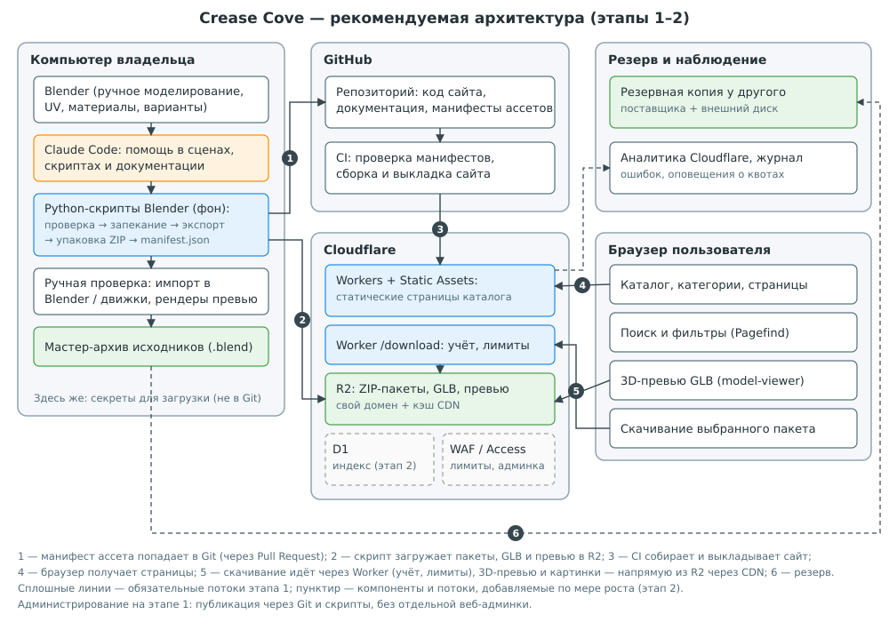
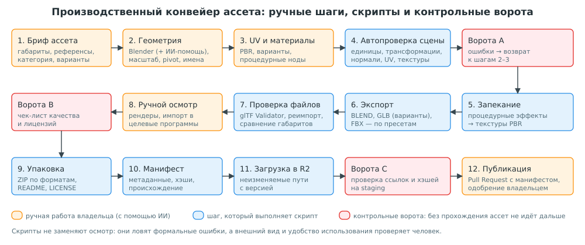

## 1. Титульная страница и сведения о документе {#s1}

| Параметр | Значение |
|---|---|
| Проект | Crease Cove (рабочее название), предполагаемый домен creasecove.com |
| Документ | Предварительное исследование и проектная документация, задание № 001 |
| Версия и статус | 1.1, черновик. Исправлена по замечаниям владельца от 18.10.2026. Требует рассмотрения и согласования владельцем |
| Дата подготовки и проверки источников | 18 октября 2026 года |
| Автор | Claude (ИИ-ассистент) по заданию владельца проекта |
| Этап проекта | Этап 0: уточнение требований и документации. Разработка сайта не начата и не разрешена |
| Бюджет текущей фазы | **0 денежных единиц.** Любые платные услуги, покупки и подписки — только по отдельному явному согласию владельца |

**Как читать документ.** Каждое существенное утверждение помечено одним из маркеров:

- **Факт** — подтверждено источником, ссылка в квадратных скобках ведёт прямо на страницу источника; полный список источников — в разделе 24. Все источники открывались 18.10.2026.
- **Вывод** — собственное заключение на основе фактов.
- **Допущение** — число или условие, принятое для расчёта; не является свойством проекта.
- **Гипотеза** — утверждение, которое нужно проверить экспериментом.
- **Рекомендация** — предлагаемое решение, требующее согласования владельцем.

Если маркер не указан, текст является пояснением или рекомендацией. Юридические выводы помечены **⚖ Требует проверки юристом**.

**Ограничения исследования.** Веб-поиск и чтение страниц были доступны, но часть сайтов не открылась (страницы Meshy, страница FBX-экспорта в руководстве Blender, RDAP-сервис Verisign). Где данные получить не удалось, это указано прямо. Прямые запросы из рабочей среды к DNS и RDAP блокировались сетевой политикой, поэтому проверка домена выполнена через публичные WHOIS-сервисы и носит предварительный характер.

### 1.1. Что изменено в версии 1.1 и почему

Владелец передал замечания к версии 1.0 (файл «Context.txt», 18.10.2026). Его требования имеют приоритет над прежними рекомендациями отчёта. Найденные противоречия и сделанные исправления:

| № | Противоречие в версии 1.0 | Исправление в версии 1.1 |
|---|---|---|
| 1 | Пилот из 10 реальных ассетов стоял в плане раньше локального прототипа сайта, а критерий готовности прототипа требовал показывать и скачивать эти 10 ассетов | План пересобран целиком (раздел 19): сначала локальный сайт на тестовых данных, затем тестирование владельцем; производство реальных ассетов — отдельная будущая фаза по решению владельца |
| 2 | Набор из 10 реальных моделей был предварительным условием разработки | Условие удалено. Для проверки интерфейса используются тестовые записи, заглушки и локальные тестовые файлы; они явно помечаются как тестовые и не выдаются за опубликованные ассеты |
| 3 | Платные компоненты (Workers Paid за $5 в месяц, R2, облачные резервные копии, мониторинг) выглядели как часть плана | Бюджет текущей фазы зафиксирован как 0. Платные варианты описаны только как необязательные сценарии возможного публичного запуска и не считаются одобренными |
| 4 | Сценарии 1 000, 10 000 и 50 000 ассетов влияли на рекомендации | Сценарии вынесены в «возможное будущее» и не являются текущими требованиями |
| 5 | Домен creasecove.com был назван «вероятно занятым» | Формулировка исправлена: доступность домена не подтверждена; публичные источники противоречат друг другу; покупки и регистрации не выполняются |
| 6 | Архитектура подавалась как рекомендованная к реализации | Архитектура описана как предварительная до утверждения технического задания; для текущей фазы используются только локальные бесплатные инструменты |
| 7 | Публичная версия, staging и деплой входили в общий план | Публичный доступ, деплой и инфраструктура — только этап 4, по отдельному решению владельца |

Остальные результаты исследования (конкуренты, гипотезы, форматы, лицензии, стандарты качества, безопасность) сохранены, поскольку они понадобятся в будущих фазах. Подробное техническое задание на локальный прототип вынесено в отдельный документ `docs/Crease_Cove_Technical_Specification.md`.

## 2. Краткое резюме проекта {#s2}

**Что такое Crease Cove.** Бесплатная онлайн-библиотека 3D-ассетов, которые владелец производит сам в Blender с помощью ИИ. Ценность проекта не в количестве моделей, а в том, что каждый ассет проверен: правильный масштаб, pivot, UV, материалы, рабочие файлы в нескольких форматах и понятная лицензия.

**Главные выводы.**

1. **Бизнес-концепция жизнеспособна как нишевый некоммерческий проект, но не как быстрорастущий бизнес.** Рынок бесплатных ассетов уже занят сильными игроками с лицензией CC0: Poly Haven, Kenney, Quaternius, ambientCG [[S36]][s36] [[S39]][s39] [[S41]][s41] [[S40]][s40]. Poly Haven сообщает о 1,4 млн скачиваний и 10,7 млн пользователей в месяц [[S38]][s38] и живёт в основном на пожертвования через Patreon [[S37]][s37]. Отличиться можно только качеством и предсказуемостью файлов в конкретной нише, а не объёмом каталога. (**Вывод**)
2. **Главное ограничение — производительность одного человека, а не технологии.** Время на один качественный ассет неизвестно. Его можно будет измерить, когда владелец отдельно решит начать производство реальных ассетов (будущая фаза, после одобрения локального прототипа). ИИ-генерация геометрии ускоряет черновик, но по независимому тесту даёт ошибки топологии, выдуманные детали и неверный масштаб [[S51]][s51].
3. **Предварительно предлагаемая архитектура — статический каталог.** Сайт собирается из файлов-манифестов (JSON) и работает локально на компьютере владельца, без базы данных, авторизации и облачных сервисов. Если в будущем владелец решит открыть сайт публично, кандидатами для размещения рассматриваются Cloudflare Workers и R2, где исходящий трафик бесплатен [[S1]][s1]; это не текущее решение. Next.js и Supabase технически подходят, но для прототипа избыточны (раздел 9). Архитектура предварительная и утверждается вместе с техническим заданием.
4. **Бюджет текущей фазы — 0.** Локальный прототип делается только бесплатными инструментами (раздел 15.0). Оценки расходов для публичной версии и сценарии роста приведены как «возможное будущее»; они не являются ни планом, ни одобренными тратами. Главный вывод этих оценок: при публичной раздаче файлов решающий параметр — плата за исходящий трафик (раздел 15).
5. **Правовые вопросы — ключевой риск.** Охраноспособность чисто ИИ-сгенерированного контента в США отрицается [[S53]][s53] [[S55]][s55]; условия ИИ-сервисов различаются: например, бесплатный тариф Tripo оставляет права на результаты за Tripo [[S48]][s48], а лицензия Hunyuan3D не действует в ЕС, Великобритании и Южной Корее [[S49]][s49]. Перед запуском нужна консультация юриста в стране владельца.
6. **Доступность домена creasecove.com не подтверждена.** Публичные сервисы дают противоречивые ответы: whois.com показывает домен как зарегистрированный [[S62]][s62], who.is не нашёл данных [[S63]][s63]. Окончательный вывод возможен только после ручной проверки (приложение Б). Никаких покупок и регистраций не выполнялось.

**Что нужно от владельца сейчас.** Ознакомиться с исправленным отчётом и техническим заданием, ответить на блокирующие вопросы раздела 22 и, если всё устраивает, утвердить техническое задание. Только после этого начинается этап 1 — разработка локального прототипа.

## 3. Концепция и цели Crease Cove {#s3}

### 3.1. Проблема, которую решает проект

**Гипотеза H1.** Пользователи бесплатных 3D-ассетов теряют время на доработку скачанных моделей: неправильный масштаб, pivot не там, где нужно, «сломанные» материалы после импорта, отсутствующие текстуры, неясная лицензия. Если эта проблема существенна для заметной группы людей, библиотека с гарантированно проверенными файлами имеет ценность даже на фоне больших каталогов.

Косвенные подтверждения (не доказательства): крупные бесплатные библиотеки подчёркивают именно единообразие и простую лицензию. Poly Haven прямо разрешает любое использование без атрибуции [[S36]][s36]; маркетплейсы вроде Fab строят многоуровневые лицензии [[S43]][s43], что создаёт для пользователя дополнительную сложность. Прямых исследований, измеряющих «боль» от некачественных бесплатных моделей, найти не удалось.

### 3.2. Цели проекта

| Цель | Как проверить достижение |
|---|---|
| Бесплатный доступ без регистрации | Скачивание работает без аккаунта; тест в чистом браузере |
| Стандартизированное качество | Каждый ассет прошёл автоматические проверки и ручной чек-лист (раздел 13); отчёт проверки хранится вместе с манифестом |
| Корректный масштаб, pivot, UV, материалы | Скрипт сравнивает габариты с брифом; чек-лист импорта в целевые программы |
| Готовые к использованию файлы | Тестовый импорт GLB, FBX и BLEND в выбранные программы на эталонных ассетах |
| Несколько вариантов оформления | Варианты описаны в манифесте; в GLB — через расширение KHR_materials_variants [[S33]][s33] |
| Удобная организация текстур | Единая структура ZIP-пакета (раздел 14), проверяемая скриптом |
| Регулярное пополнение | Измеренный темп производства в будущей фазе создания ассетов; публичных обещаний частоты до этого не давать |
| Прозрачная лицензия и происхождение | У каждого ассета есть запись о происхождении всех сторонних ресурсов (раздел 16) |

### 3.3. Чем проект не является (границы)

- Не маркетплейс: нет продавцов, оплаты и загрузки моделей пользователями. Это резко снижает юридические и технические риски (**Вывод**).
- Не генератор моделей «по запросу»: пользователь получает готовые проверенные пакеты.
- Не социальная сеть: на старте нет аккаунтов, комментариев и рейтингов.

## 4. Оценка бизнес-жизнеспособности {#s4}

### 4.1. Аргументы «за»

- **Низкая стоимость инфраструктуры.** При хранении в R2 исходящий трафик бесплатен [[S1]][s1], а статические файлы на Workers раздаются без ограничений по числу запросов [[S3]][s3]. Это позволяет бесплатно отдавать большие файлы, что раньше было главной статьёй расходов бесплатных библиотек. (**Факт** + **Вывод**)
- **Подтверждённый спрос на бесплатные ассеты в целом.** Poly Haven заявляет 1,4 млн скачиваний и 10,7 млн пользователей в месяц [[S38]][s38]. Это данные одного, причём лидирующего, проекта; они показывают, что спрос существует, но не говорят, какую долю может получить новый участник.
- **Изменения на рынке.** Sketchfab закрыл свой магазин в октябре 2024 года при запуске Fab [[S44]][s44], а в августе 2026 года Sketchfab и ArtStation были проданы компании KitBash [[S45]][s45]. Часть авторов и пользователей ищет стабильные альтернативы, но это окно возможностей, а не гарантия трафика. (**Вывод**)
- **Инструменты ИИ и автоматизации Blender** снижают трудоёмкость рутинных операций: экспорта, проверки, упаковки и генерации метаданных. Blender поддерживает запуск Python-скриптов в фоновом режиме из командной строки [[S30]][s30].

### 4.2. Аргументы «против»

- **Сильная бесплатная конкуренция с лицензией CC0**: Poly Haven, Kenney, Quaternius, ambientCG [[S36]][s36] [[S39]][s39] [[S41]][s41] [[S40]][s40]. Пользователю, которому нужен «стул», уже есть где его взять бесплатно.
- **Бесплатность исключает прямой доход.** Модель пожертвований работает у Poly Haven, но там команда и годы накопленной репутации [[S37]][s37].
- **Производительность одного человека.** Если качественный ассет требует 2–6 часов работы (**Допущение**, требует измерения), то 1 000 ассетов — это 2 000–6 000 часов, то есть 1–3 года полной занятости. Сценарии 10 000 и 50 000 ассетов в одиночку, без существенной автоматизации или найма, нереалистичны. (**Вывод**)
- **Риск восприятия ИИ-контента.** Часть аудитории негативно относится к ИИ-ассетам; Fab даже предусматривает тег NoAI для стандартной лицензии [[S43]][s43]. Позиционирование «сделано с помощью ИИ» может отпугнуть часть пользователей. (**Вывод**)
- **SEO-конкуренция.** Запросы вида «free 3D model chair» заняты крупными сайтами; новому домену трудно попасть в топ без накопленных ссылок. Количественных данных о поисковом спросе получить не удалось: инструменты оценки ключевых слов требуют регистрации, что на этом этапе запрещено.

### 4.3. Общий вывод

**Вывод.** Проект оправдан как недорогой эксперимент с чётко ограниченными вложениями времени и денег и с заранее определёнными критериями остановки или разворота. Он не оправдан как ставка на быстрый рост или доход. Решение о масштабировании должно приниматься после проверки гипотез H1–H6 (раздел 4.4) на минимальной версии.

### 4.4. Проверяемые гипотезы и способы проверки до крупных вложений

| № | Гипотеза | Как проверить дёшево | Критерий успеха (предложение) |
|---|---|---|---|
| H1 | Пользователям важна «проверенность» файлов, а не только количество | 5–10 интервью или опрос в сообществах Blender/геймдева; анализ жалоб в комментариях к бесплатным моделям | Не менее половины опрошенных называют доработку импорта заметной проблемой |
| H0 | Структура сайта (каталог, страница ассета, поиск, скачивание) понятна и удобна | Локальный прототип на тестовых данных, проверка владельцем (этапы 1–2) | Владелец одобряет прототип |
| H2 | Владелец может стабильно производить ассеты нужного качества | Будущая фаза по решению владельца: первые реальные ассеты с замером времени по шагам; количество определяет владелец | Медианное время на ассет известно; большинство ассетов проходит проверки |
| H3 | Есть ниша, где Crease Cove может быть лучше конкурентов | Аудит Poly Haven, Kenney, Quaternius, Fab по 3–5 кандидатным нишам | Найдена ниша с малым числом качественных CC0-ассетов |
| H4 | Посетители скачивают, а не только смотрят | Только при возможной публичной версии (этап 4): учёт скачиваний | Измеримая доля посетителей скачивает хотя бы один пакет (порог задаётся владельцем после первых данных) |
| H5 | Канал привлечения работает без бюджета | Публикации в 2–3 сообществах, рассылка подборок, наборы ассетов на itch.io | Повторные визиты и упоминания без платной рекламы |
| H6 | ИИ-ассистированное производство не снижает доверие | Явная маркировка «сделано с помощью ИИ» и сбор отзывов | Нет устойчивых негативных отзывов, связанных с ИИ |

Пороговые числа сознательно не заданы: без первых данных любые цифры были бы выдуманными. Для текущей фазы проверяется только H0; остальные гипотезы относятся к будущим фазам.

## 5. Анализ рынка и конкурентов {#s5}

### 5.1. Сравнение основных альтернатив

| Платформа | Модель | Лицензия на ассеты | Что важно для Crease Cove |
|---|---|---|---|
| Poly Haven | Бесплатно, пожертвования (Patreon) и спонсоры | CC0, атрибуция не нужна, разрешено перераспространение [[S36]][s36] | Эталон качества и лицензирования; небольшая студия из ЮАР, 12 человек в титрах [[S37]][s37]; 1,4 млн скачиваний в месяц [[S38]][s38] |
| Kenney | Бесплатно, пожертвования | CC0 [[S39]][s39] | Сильный бренд в инди-геймдеве, стилизованные low-poly наборы |
| Quaternius | «Плати сколько хочешь», Patreon | CC0 [[S41]][s41] | Наборы low-poly моделей для игр; часть контента — для подписчиков |
| ambientCG | Бесплатно | CC0 1.0 для файлов и превью [[S40]][s40] | Главным образом материалы и текстуры; потенциальный источник текстур |
| Blendkit (бывший BlenderKit) | Бесплатный и платный планы | Royalty-free: можно использовать коммерчески, но нельзя продавать сами ассеты [[S42]][s42] | Интеграция прямо в Blender — сильное удобство |
| Fab (Epic Games) | Маркетплейс, есть бесплатные позиции | CC-BY (бесплатно) и Standard (личный/профессиональный уровень, порог $100 000 выручки) [[S43]][s43] | Огромный каталог, сложная лицензионная модель |
| Sketchfab | Просмотр и публикация; магазин закрыт 22.10.2024 [[S44]][s44] | Бесплатные модели под Creative Commons [[S44]][s44] | Продан KitBash в августе 2026 года; Fab остался у Epic [[S45]][s45] |
| CGTrader | Маркетплейс, авторы получают 70–80% [[S46]][s46] | Коммерческие лицензии | Основан в 2011 году в Вильнюсе; заявлял 800 000 моделей и 2 млн пользователей в мае 2019 года [[S46]][s46] |
| TurboSquid | Маркетплейс | Коммерческие лицензии | Куплен Shutterstock [[S47]][s47] |

Данные о размере каталогов и аудитории приведены только там, где их публикует сам источник; более свежих независимых цифр найти не удалось.

### 5.2. ИИ-генерация 3D как конкурент и как инструмент

| Сервис/модель | Условия, важные для проекта |
|---|---|
| Tripo | Платные пользователи получают полные права на сгенерированные модели; на бесплатном тарифе права на входные данные и результаты сохраняет Tripo [[S48]][s48] |
| Meshy | Официальные страницы с условиями не открылись при проверке; условия **не подтверждены**. Независимый тест версии Meshy-7.1 нашёл многосоставные неманифолдные сетки, выдуманные детали и отсутствие реального масштаба [[S51]][s51] |
| Hunyuan3D 2.0 (Tencent) | Лицензия не действует на территории ЕС, Великобритании и Южной Кореи; требует отдельной лицензии при более чем 1 млн активных пользователей в месяц; публикация машинно-сгенерированного контента без маркировки запрещена политикой использования [[S49]][s49] |
| TRELLIS.2 (Microsoft) | Модель выпущена под лицензией MIT [[S50]][s50]; запуск требует мощной видеокарты (рекомендуется CUDA 12.4) |

**Вывод.** ИИ-генераторы одновременно конкурент (пользователь может сгенерировать модель сам) и инструмент (черновик геометрии). Защита от этой конкуренции — то, чего генераторы не дают: проверенная топология, реальные размеры, чистые UV, корректные материалы, несколько форматов, ясная лицензия.

### 5.3. Как выделиться

1. **Узкая ниша на старте.** Например, «предметы интерьера с реальными размерами» или «пропсы для прототипирования игр в едином масштабе». Выбор ниши — решение владельца после аудита H3.
2. **Гарантия «открыл и работает».** Публичный стандарт качества и отчёт проверки на странице каждого ассета.
3. **Варианты материалов в одном GLB** через KHR_materials_variants [[S33]][s33]; конкуренты делают это редко (**Гипотеза**, требует аудита).
4. **Прозрачное происхождение**: из чего сделан ассет и какие ИИ-инструменты использовались.
5. **Наборы (kits)** — согласованные по стилю коллекции, а не разрозненные модели.

### 5.4. Риск копирования концепции

Концепцию легко повторить, а при лицензии CC0 любой может законно перераспространять сами ассеты, как прямо разрешают Poly Haven и ambientCG для своих файлов [[S36]][s36] [[S40]][s40]. Защищаемые активы проекта — бренд, репутация качества, производственный конвейер и регулярность. (**Вывод**)

### 5.5. Привлечение аудитории и SEO

- Отдельная индексируемая страница на каждый ассет с уникальным описанием, размерами и характеристиками; при статической генерации это получается автоматически.
- Структурированные данные, карта сайта, понятные URL.
- Публикации в сообществах Blender и инди-геймдева, наборы на itch.io (так распространяет свои ассеты Quaternius [[S41]][s41]).
- Возможный будущий канал — дополнение для Blender, как у Blendkit [[S42]][s42]. Это отдельный проект, его не стоит делать в первой версии.

### 5.6. Возможные источники дохода в будущем (не утверждены)

Пожертвования и подписка на Patreon (модель Poly Haven [[S37]][s37]), спонсорство студий, платные заказные модели, ранний доступ к наборам (модель Quaternius [[S41]][s41]), ненавязчивая реклама. Каждый вариант меняет восприятие «бесплатной библиотеки», поэтому решение откладывается до появления аудитории.

### 5.7. Ключевые факторы успеха

Качество и единообразие файлов; устойчивый темп производства; ясная лицензия; выбор ниши; находимость в поиске; доверие к ИИ-ассистированному производству; низкие постоянные расходы.

## 6. Целевая аудитория и пользовательские потребности {#s6}

| Сегмент | Основные задачи | Что важно в ассете | Предпочтительные форматы (**Допущение**, проверить опросом) |
|---|---|---|---|
| Инди-разработчики игр | Быстро наполнить сцену, прототип | Low/mid-poly, LOD, правильный pivot, лёгкие текстуры, лицензия без атрибуции | GLB/glTF (Godot, веб), FBX (Unity, Unreal) |
| Пользователи Blender, 3D-художники | Наполнение сцен, рендеры | Высокое качество материалов, процедурные ноды, реальные размеры | BLEND |
| Визуализаторы (архитектура, интерьер, предметы) | Реалистичные интерьеры | Реальные размеры, PBR, варианты отделки | BLEND, FBX |
| Разработчики веб/AR-приложений | Модели для браузера и AR | Малый размер файла, GLB с встроенными текстурами | GLB, позднее USDZ |
| Прототипировщики, преподаватели, студенты | Учебные проекты | Простая лицензия, понятная структура | Любой |

**Общие потребности:** быстро найти нужное (категории, поиск, фильтры), увидеть объект до скачивания (рендер, 3D-превью, габариты, число полигонов), скачать без регистрации, понимать лицензию с первого взгляда.

## 7. Функциональные требования {#s7}

Приоритеты: **Прототип** — входит в локальный прототип (этап 1), работает на тестовых данных; **Публичная** — нужно только если владелец решит открыть сайт (этап 4); **Позже** — после подтверждения спроса; **Не нужно** — избыточно для проекта такого масштаба. Подробные требования к прототипу с критериями приёмки — в техническом задании.

| № | Функция | Приоритет | Обоснование |
|---|---|---|---|
| F1 | Главная страница (новое, категории, кратко о проекте и лицензии) | Прототип | Точка входа, объясняет ценность |
| F2 | Категории и подкатегории (2 уровня) | Прототип | Основной способ навигации при малом каталоге |
| F3 | Каталог со списком и миниатюрами | Прототип | — |
| F4 | Страница ассета: превью, габариты, полигоны, форматы, варианты, лицензия, происхождение | Прототип (на тестовых данных) | Основная ценность проекта |
| F5 | Скачивание ZIP-пакета по выбранному варианту и формату | Прототип (локальные тестовые файлы) | Основная функция |
| F6 | Страница лицензии и стандарта качества | Прототип (текст-заглушка) | Доверие и правовая ясность |
| F7 | Интерактивное 3D-превью (GLB) | Прототип (тестовые GLB) | Дёшево реализуется готовым компонентом model-viewer, поддерживающим glTF и варианты материалов [[S35]][s35] |
| F8 | Поиск по названию и тегам | Прототип | Работает локально после сборки (Pagefind [[S25]][s25]) |
| F9 | Фильтры (категория, формат, полигоны, стиль) и сортировка | Прототип | — |
| F10 | «Новые» | Прототип | Тривиально при статической сборке |
| F11 | «Популярные» | Публичная | Требует реального учёта скачиваний; локально его нет |
| F12 | Сравнение вариантов на одной странице | Прототип | Переключение вариантов в превью |
| F13 | Правовые страницы: условия, конфиденциальность, обращения правообладателей | Публичная (обязательно до публичного запуска); в прототипе — заглушки | Раздел 16 |
| F14 | Административное добавление и обновление ассетов | Прототип — ручное редактирование тестовых JSON-файлов и Git; веб-админка — Позже | Раздел 10.5 |
| F15 | Наборы (коллекции) | Позже | Полезно для отличия от конкурентов |
| F16 | Аккаунты пользователей, избранное | Позже | Требует аутентификации, политики персональных данных, усложняет поддержку |
| F17 | Генерация архивов «на лету» по выбору пользователя | Не нужно | Готовые пакеты проще, дешевле и надёжнее (раздел 14). Текущий README репозитория описывает генерацию на лету; это противоречие вынесено в открытые вопросы |
| F18 | Комментарии, рейтинги, загрузка моделей пользователями | Не нужно на обозримом этапе | Модерация и юридические риски несоразмерны |
| F19 | Многоязычный интерфейс | Позже | Решение о языке сайта — в разделе 22 |

## 8. Нефункциональные требования {#s8}

| № | Требование | Целевое значение (предложение) | Как проверить |
|---|---|---|---|
| N1 | Надёжность файлов | 100% опубликованных пакетов проходят проверку целостности (хэш SHA-256) | Скрипт сверяет хэши в манифесте и в хранилище |
| N2 | Битые ссылки | 0 при каждой сборке | Автоматическая проверка всех ссылок при каждой сборке (локально, затем — на каждой выкладке публичной версии) |
| N3 | Производительность | Страница каталога загружается быстро на мобильном соединении; превью не блокирует первую отрисовку | Lighthouse или аналог, ручная проверка |
| N4 | Доступность сервиса | Для прототипа не применимо (локальный запуск); для публичной версии — без формального SLA | — |
| N5 | Стоимость | Прототип — 0 денежных единиц, только бесплатные локальные инструменты. Публичная версия — бюджет отдельно согласует владелец | Отсутствие платных подписок и привязанных платёжных средств |
| N6 | Обслуживаемость одним человеком | Добавление записи — правка одного JSON-файла; сайт запускается одной командой | Проверка на прототипе |
| N7 | Переносимость | Все данные каталога хранятся в открытых форматах (JSON, ZIP) | Проверка структуры файлов |
| N8 | Безопасность | Нет секретов в Git; админ-операции только у владельца | Сканирование секретов, ревью настроек |
| N9 | Восстановление | Каталог восстанавливается из Git и резервной копии файлов | Ежеквартальная тренировка восстановления |
| N10 | Доступность интерфейса (accessibility) | Базовые требования: альтернативный текст, клавиатурная навигация, контраст | Автоматическая проверка и ручной тест |
| N11 | Конфиденциальность | Минимальный сбор данных; в прототипе нет аналитики и сторонних трекеров | Ревью кода и настроек аналитики |

## 9. Сравнение технологических решений {#s9}

Все цены — без налогов, по официальным страницам на 18.10.2026. Цены меняются; перед покупкой перепроверить.

### 9.1. Фронтенд и способ генерации страниц

| Критерий | Next.js (через адаптер OpenNext на Workers) | Astro (статическая генерация, при необходимости гибридная) | Чистый статический генератор без фреймворка |
|---|---|---|---|
| Назначение | Универсальный React-фреймворк для динамических приложений | Фреймворк для контентных сайтов; по умолчанию генерирует статический HTML | Минимальный сайт из шаблонов |
| Плюсы | Огромная экосистема, много обучающих материалов, ИИ хорошо знает фреймворк | Простая модель «контент → HTML»; статический сайт на Cloudflare не требует адаптера [[S17]][s17]; можно включить серверный рендеринг отдельных страниц | Максимальная простота |
| Минусы | Сложная модель кэширования и рендеринга; на Workers работает через отдельный адаптер OpenNext [[S15]][s15] [[S16]][s16]; на бесплатном плане Workers лимит 10 мс CPU на запрос [[S4]][s4], что неудобно для серверного рендеринга | Меньше экосистема; с января 2026 года принадлежит Cloudflare [[S18]][s18] (обещано, что проект останется открытым) | Всё, что сложнее списка страниц (поиск, фильтры, превью), придётся писать самому |
| Сложность для одного человека | Высокая | Низкая или средняя | Низкая на старте, растёт со временем |
| Бесплатные ограничения | Зависят от хостинга (см. 9.3) | Статические файлы на Workers бесплатны [[S3]][s3] | То же |
| Привязка к поставщику | Низкая (открытый код, MIT), но адаптер OpenNext — внешняя зависимость | Низкая (MIT); риск — изменение приоритетов после покупки Cloudflare | Нет |
| Зрелость (по npm, 18.10.2026) | next 16.4.2; @opennextjs/cloudflare 1.20.12 [[S26]][s26] | astro 7.4.0 [[S26]][s26] | — |

**Вывод.** Каталог Crease Cove — по сути контентный сайт: данные меняются только при публикации ассета владельцем. Для такой задачи статическая генерация проще, дешевле и надёжнее серверного рендеринга. Next.js оправдан, если с первого дня нужны аккаунты, персонализация и динамическая админка, а это противоречит согласованному объёму локального прототипа.

### 9.2. Язык: TypeScript

TypeScript (JavaScript с проверкой типов) рекомендуется при любом фреймворке: ошибки в структуре манифеста ассета ловятся при сборке, а не у пользователя. Для скриптов Blender используется Python — это язык встроенного API Blender [[S30]][s30]. Минус TypeScript — дополнительный шаг сборки; для проекта такого размера он незначителен.

### 9.3. Хостинг сайта

| Критерий | Cloudflare Workers (статические файлы + функции) | Cloudflare Pages | Vercel |
|---|---|---|---|
| Бесплатный план | 100 000 запросов к функциям в день, 10 мс CPU; запросы к статическим файлам бесплатны и не ограничены [[S3]][s3] | Существует, но у Workers «заметно более широкий набор функций», есть официальное руководство по миграции с Pages на Workers [[S5]][s5] | Hobby: только некоммерческое личное использование [[S21]][s21] |
| Платный план | От $5 в месяц: 10 млн запросов и 30 млн CPU-мс включено, далее $0,30 за 1 млн запросов [[S3]][s3] | — | Pro: $20 за разработчика в месяц [[S21]][s21] |
| Лимиты статических файлов | 20 000 файлов на версию (бесплатно), 100 000 (платно), до 25 МиБ на файл [[S4]][s4] | — | — |
| Сборка | Workers Builds: 3 000 минут в месяц бесплатно, тайм-аут 20 минут [[S6]][s6] | — | — |
| Переносимость | Статический сайт переносится на любой хостинг | То же | То же |

**Вывод.** Workers предпочтительнее Pages для нового проекта: Cloudflare развивает Workers как более функциональную платформу [[S5]][s5]. Vercel Hobby не подходит, если проект когда-либо станет коммерческим [[S21]][s21].

**Важное ограничение.** Лимит 20 000 статических файлов на бесплатном плане [[S4]][s4] означает, что полностью статический каталог упрётся в него на нескольких тысячах ассетов: каждая страница ассета, а также фрагменты поискового индекса — отдельные файлы. Точный порог зависит от реализации и должен быть измерен (**Гипотеза**). Это один из триггеров перехода к этапу 2 архитектуры (раздел 10.6).

### 9.4. База данных

| Критерий | Без БД: манифесты JSON в Git | Cloudflare D1 (SQLite) | Supabase (PostgreSQL) | Neon (PostgreSQL) |
|---|---|---|---|---|
| Назначение | Источник истины — файлы, сайт собирается из них | Бессерверная SQL-БД рядом с Workers | Postgres + авторизация + хранилище + табличный редактор | Бессерверный Postgres |
| Бесплатно | Без ограничений (в пределах GitHub) | 5 млн прочитанных строк в день, 100 000 записей в день, 5 ГБ [[S3]][s3] | 500 МБ БД, 2 активных проекта; **проект приостанавливается после недели неактивности**; без автоматических резервных копий [[S19]][s19] | 1 ГБ на проект, вычисления засыпают после 5 минут простоя [[S20]][s20] |
| Платно | — | В составе Workers Paid ($5): 25 млрд чтений, 50 млн записей, 5 ГБ, далее $0,75 за ГБ-месяц [[S3]][s3] | Pro от $25 в месяц: 8 ГБ, ежедневные копии 7 дней, 250 ГБ трафика, далее $0,09 за ГБ [[S19]][s19] | Launch: без минимума, $0,106 за CU-час, $0,35 за ГБ-месяц [[S20]][s20] |
| Поиск | Статический индекс в браузере | Полнотекстовый поиск FTS5 [[S12]][s12] | Полнотекстовый поиск Postgres | То же |
| Переносимость | Максимальная | Экспорт в SQL командой `wrangler d1 export`, но виртуальные таблицы (FTS5) не экспортируются [[S13]][s13] | Стандартный pg_dump | Стандартный pg_dump |
| Сложность | Минимальная | Низкая | Средняя (ещё один поставщик, политики доступа, ключи) | Средняя |

**Вывод.** Для локального прототипа и возможной первой публичной версии база данных не нужна: несколько сотен или тысяч записей легко обрабатываются при сборке. Когда понадобятся динамические фильтры по большому каталогу или счётчики популярности, D1 даёт нужное с минимальными затратами в той же платформе. Supabase стоит выбирать, если появятся аккаунты пользователей или потребуется готовая веб-админка; но бесплатный проект засыпает после недели без активности [[S19]][s19], что для публичного сайта неприемлемо; постоянная работа потребовала бы платного плана, а платные планы в текущей фазе исключены.

### 9.5. Файловое хранилище

| Критерий | Cloudflare R2 | Backblaze B2 | Supabase Storage |
|---|---|---|---|
| Хранение | $0,015 за ГБ-месяц; 10 ГБ бесплатно [[S1]][s1] | $6,95 за ТБ в месяц; первые 10 ГБ бесплатно [[S22]][s22] | 1 ГБ бесплатно; на Pro 100 ГБ включено, далее $0,0213 за ГБ [[S19]][s19] |
| Исходящий трафик | **$0** [[S1]][s1] | Бесплатно до трёхкратного объёма хранения, далее $0,01 за ГБ [[S22]][s22] | На Pro 250 ГБ включено, далее $0,09 за ГБ [[S19]][s19] |
| Операции | Класс A $4,50, класс B $0,36 за 1 млн; бесплатно 1 млн A и 10 млн B в месяц [[S1]][s1] | Большинство классов бесплатны, класс D $0,004 за 10 000 [[S22]][s22] | — |
| Совместимость | S3 API | S3 API | Собственный API |
| Роль в проекте | **Основное хранилище и раздача** | **Кандидат для резервной копии** у другого поставщика | Не рекомендуется для раздачи больших файлов |

**Вывод.** Для библиотеки, раздающей большие файлы, решающий параметр — стоимость исходящего трафика. R2 устраняет этот риск. Важная оговорка: доступ через тестовый адрес r2.dev ограничен по скорости и не предназначен для продакшена; для публичной раздачи нужен собственный домен, который также даёт кэш CDN, WAF и контроль доступа [[S7]][s7].

### 9.6. Git и GitHub

**Рекомендация.** Git для всего текстового: код, документация, манифесты ассетов, скрипты. GitHub для хранения, Pull Request как механизм публикации ассета и CI. Бесплатно: 2 000 минут GitHub Actions в месяц для приватных репозиториев, без ограничений для публичных [[S24]][s24].

**Важно:** бинарные 3D-файлы и текстуры не хранить в Git: репозиторий быстро разрастётся. Мастер-файлы хранятся на диске владельца и в резервной копии, опубликованные пакеты — в R2.

### 9.7. Предварительно предлагаемый стек и альтернатива

**Статус.** Стек — предварительное предложение. Он утверждается владельцем вместе с техническим заданием; до этого ничего не устанавливается. В текущей фазе используются только локальные бесплатные части стека. Облачные компоненты (Cloudflare Workers, R2, D1) относятся к возможной публичной версии.

**Основной предлагаемый стек (Вариант A, «статический каталог»):**

- Astro + TypeScript, статическая генерация страниц из манифестов ассетов;
- локальный запуск: сервер разработки Astro и локальный просмотр собранного сайта (этап 1);
- только для возможной публичной версии: Cloudflare Workers (статические файлы) для сайта и один небольшой Worker для скачиваний;
- только для возможной публичной версии: Cloudflare R2 для пакетов, GLB и изображений, с собственным доменом (в прототипе файлы лежат локально);
- Pagefind для поиска: статический индекс в браузере, на сайте из 10 000 страниц сетевой объём поиска меньше 300 КБ [[S25]][s25];
- model-viewer для 3D-превью [[S35]][s35];
- Git и GitHub (бесплатно) для истории изменений и проверки правок через Pull Request;
- Blender + Python-скрипты на компьютере владельца;
- на этапе 2 — Cloudflare D1 как индекс каталога и счётчик скачиваний.

**Почему.** Минимум движущихся частей; нулевая стоимость в текущей фазе; при возможной публикации — один хостинг-поставщик плюс GitHub; нет базы данных и админ-панели, которые надо защищать; всё содержимое каталога — открытые файлы в Git, что даёт полную переносимость.

**Компромиссы и недостатки варианта A.** Концентрация на одном поставщике (Cloudflare владеет хостингом, хранилищем и с 2026 года фреймворком Astro [[S18]][s18]); ограничение на число статических файлов [[S4]][s4]; при росте сборка удлиняется (тайм-аут сборки на Workers Builds 20 минут [[S6]][s6]); нет удобной веб-админки — публикация идёт через скрипты и GitHub.

**Альтернативный стек (Вариант B, «динамическое приложение»):** Next.js + TypeScript + Supabase Postgres. Подходит, если владелец решит, что аккаунты, избранное, веб-админка и динамические функции нужны с первой версии. Локально его можно запускать бесплатно, но для постоянной публичной работы, скорее всего, понадобились бы платные планы (бесплатный проект Supabase приостанавливается после недели неактивности [[S19]][s19]). Сложность заметно выше. Для текущей фазы не рекомендуется.

**Компоненты, которые не рекомендуются сейчас:** Kubernetes, микросервисы, очереди, отдельный поисковый сервер (Elasticsearch, Algolia), собственный сервер для генерации архивов.

## 10. Рекомендуемая архитектура {#s10}

> **Статус раздела.** Описанная ниже схема с Cloudflare — целевой вариант для **возможной публичной версии** (этап 4), а не текущий объём работ. Локальный прототип устроен проще: весь сайт, тестовые данные и тестовые файлы находятся на компьютере владельца, а сайт открывается в браузере по локальному адресу. Схема локального прототипа приведена в техническом задании.

### 10.1. Принцип

Сайт — витрина, которая только читает данные. Все изменения каталога происходят в одном месте: на компьютере владельца через скрипты и Pull Request в Git. Это устраняет целый класс угроз: в интернете нет формы, через которую можно изменить каталог.

### 10.2. Компоненты и где они работают

| Компонент | Где работает | Ответственность |
|---|---|---|
| Blender и Python-скрипты | Компьютер владельца | Производство, проверка, запекание, экспорт, упаковка, генерация манифеста |
| Claude Code | Компьютер владельца и GitHub | Помощь в написании скриптов, кода, документации, проверке |
| Мастер-архив исходников | Компьютер владельца + резервная копия | Исходные .blend, рабочие текстуры, брифы |
| Репозиторий GitHub | Облако GitHub | Код сайта, документация, манифесты ассетов, история изменений |
| CI (GitHub Actions или Workers Builds) | Облако | Проверка манифестов, сборка, выкладка сайта |
| Статический сайт | Cloudflare Workers (статика) → браузер | HTML-страницы каталога, стили, поисковый индекс |
| Worker скачиваний | Cloudflare Workers (сервер) | Проверка запроса, ограничение частоты, учёт, выдача файла из R2 |
| Хранилище R2 | Cloudflare | ZIP-пакеты, GLB для превью, изображения |
| Поиск и фильтры | Браузер пользователя | Pagefind загружает только нужные части индекса [[S25]][s25] |
| 3D-превью | Браузер пользователя | model-viewer загружает облегчённый GLB из R2 |
| Аналитика и журнал ошибок | Cloudflare (встроенная аналитика); опционально Sentry | Наблюдение за ошибками и квотами |
| Резервная копия | Другой поставщик (например, Backblaze B2) + внешний диск | Восстановление после потери данных |

### 10.3. Хранение превью и выдача файлов

- Изображения-превью (рендеры) генерируются при производстве в нескольких размерах и лежат в R2 по неизменяемым путям с версией, например `assets/chair-oak-01/v1/preview-800.webp`. Неизменяемые пути позволяют кэшировать их «навсегда».
- Скачивание идёт по ссылке вида `/download/chair-oak-01/v1/glb/oak`. Worker проверяет, что такой пакет есть в манифесте, применяет ограничение частоты и отдаёт файл из R2 потоком либо перенаправляет на кэшируемый адрес. Выбор между потоковой отдачей и перенаправлением — техническое решение этапа прототипа; оба варианта не создают платы за трафик в R2 [[S1]][s1].
- Прямые публичные ссылки на R2 допустимы для превью; для пакетов лучше идти через Worker, чтобы считать скачивания и ограничивать злоупотребления.

### 10.4. Поиск и фильтрация

- Прототип: категории и теги, генерируемые при сборке, и Pagefind с фильтрами по категории, формату и стилю [[S25]][s25]; всё работает локально.
- Этап 2: если каталог превысит возможности статического индекса или лимит файлов, перенести фильтрацию в D1 с полнотекстовым поиском FTS5 [[S12]][s12]; при этом учесть, что виртуальные таблицы FTS5 не попадают в экспорт D1 и должны пересоздаваться из манифестов [[S13]][s13].

### 10.5. Варианты организации публикации

| Вариант | Как работает | Плюсы | Минусы | Когда |
|---|---|---|---|---|
| 1. Ручная админ-панель | Веб-форма: загрузка файлов, ввод метаданных | Привычно, не нужен Git | Нужна аутентификация, защита формы, проверка загружаемых файлов на сервере; ручной ввод — источник ошибок | Не рекомендуется для MVP |
| 2. Автоматизированная загрузка пакетов | Скрипт на компьютере владельца проверяет пакет, загружает в R2 и создаёт манифест; публикация — Pull Request с манифестом | Нет публичной админки; всё проверяется до публикации; история в Git | Нужно освоить базовые операции Git (Claude Code может их выполнять) | **Рекомендуется** (в прототипе — ручная правка тестовых JSON-файлов) |
| 3. Глубокая интеграция с Blender | Дополнение Blender с кнопкой «Опубликовать», вызывающее те же скрипты | Максимальное удобство | Разработка и поддержка дополнения | После того как вариант 2 стабилен и производство идёт регулярно |

**Переход 2 → 3** не требует изменений сайта: дополнение Blender вызывает те же проверки и упаковку, просто через интерфейс. Это главный довод в пользу варианта 2: автоматизация наращивается поверх него.

### 10.6. Этапы архитектуры и триггеры перехода

| Этап | Состав | Триггер перехода к следующему |
|---|---|---|
| 1 (возможная первая публичная версия) | Статический сайт + Worker скачиваний + R2 + манифесты в Git | Каталог приближается к лимиту статических файлов; сборка дольше ~10 минут; нужны «популярные» по реальным данным |
| 2 | + D1 как индекс каталога и счётчики; страницы каталога с серверным рендерингом; возможно, платный план Workers (только по отдельному решению владельца) | Нужны аккаунты, избранное или совместная работа нескольких авторов |
| 3 | + аутентификация (например, Cloudflare Access для админки, бесплатно до 50 пользователей [[S11]][s11]); веб-интерфейс модерации; возможно, Postgres | — |

### 10.7. Резервное копирование и мониторинг (кратко; подробно в разделе 17)

Источник истины для каталога — Git; для файлов — мастер-архив владельца. R2 рассматривается как «витрина», которую можно пересобрать из этих двух источников. Мониторинг: встроенная аналитика Cloudflare, оповещения о расходах, журнал ошибок Worker, внешний пинг доступности.

## 11. Архитектурная схема {#s11}

> Схема показывает **возможную публичную архитектуру** (этап 4). Она не входит в текущий объём работ и не означает решения о публикации или о платных услугах.



**Пояснение к схеме.**

- **На компьютере владельца** остаются: Blender, Claude Code, скрипты производства и проверки, мастер-архив, ключи доступа для загрузки. Эти компоненты не доступны из интернета.
- **На серверах** (Cloudflare и GitHub) работают: сборка сайта, раздача статических страниц, Worker скачиваний, хранилище R2.
- **В браузере пользователя** выполняются: отображение каталога, поиск по статическому индексу, 3D-превью.

**Номера стрелок на схеме:** 1 — манифест ассета попадает в Git через Pull Request; 2 — скрипт загружает пакеты, GLB и превью в R2; 3 — CI собирает и выкладывает сайт; 4 — браузер получает страницы; 5 — скачивание идёт через Worker (учёт, лимиты), а 3D-превью и картинки загружаются напрямую из R2 через CDN; 6 — резервное копирование мастер-архива и пакетов.

Поток публикации: скрипт на компьютере владельца проверяет ассет, загружает пакеты в R2 и создаёт манифест → владелец открывает Pull Request с манифестом → CI проверяет манифест и наличие файлов → после слияния сайт пересобирается и выкладывается.

## 12. Производственный процесс создания ассетов {#s12}

> **Статус раздела.** Производство реальных ассетов — **будущая фаза**. Она начинается только по отдельному решению владельца после одобрения локального прототипа (этап 3). Для прототипа реальные ассеты не нужны.

### 12.1. Анализ предложенного процесса

Предложенные владельцем 11 шагов логичны, но в них не хватает трёх вещей:

1. **Брифа до начала моделирования** (габариты, референсы, категория, список вариантов, бюджет полигонов). Без него невозможно автоматически проверить масштаб.
2. **Явных контрольных ворот** между шагами: ассет с ошибкой не должен доходить до экспорта.
3. **Записи о происхождении** всех сторонних ресурсов (текстуры, HDRI, ИИ-инструменты) с самого начала, а не на этапе публикации.

### 12.2. Рекомендуемый конвейер



### 12.3. Что можно автоматизировать, а что нет

| Шаг | Кто выполняет | Надёжность автоматизации | Комментарий |
|---|---|---|---|
| Бриф | Владелец (ИИ помогает собрать референсы и размеры) | — | Размеры реальных предметов ИИ может ошибочно «вспомнить»: проверять по источникам |
| Геометрия | Владелец в Blender; ИИ — черновики, скрипты для типовых форм | Низкая | ИИ-генераторы дают ошибки топологии и выдуманные детали [[S51]][s51]; генерация — только черновик |
| Масштаб, pivot, трансформации, имена | Скрипт исправляет и проверяет | Высокая | Чисто формальные правила |
| UV-развёртка | Владелец; скрипт проверяет | Средняя | Скрипт находит перекрытия, выход за 0–1 и разброс плотности текселей; качество швов оценивает человек |
| Материалы | Владелец | Низкая | Скрипт проверяет только соответствие правилам (Principled BSDF, наличие карт, цветовые пространства) |
| Варианты | Владелец; скрипт собирает и проверяет | Средняя | — |
| Запекание | Скрипт | Средняя или высокая | Результат обязательно смотрит человек: артефакты, швы, разрешение |
| Экспорт | Скрипт с фиксированными пресетами | Высокая | Пресеты версионируются в Git |
| Проверка экспортированных файлов | Скрипт: валидатор glTF [[S34]][s34], реимпорт, сравнение | Высокая для формальных ошибок | Не ловит «выглядит плохо» |
| Тестовый импорт в целевые программы | Владелец | Низкая | Выборочно: каждый новый тип ассета, смена версии экспортёра, каждый N-й ассет |
| Превью | Скрипт рендерит по шаблону сцены | Высокая | Человек утверждает |
| Упаковка, манифест, хэши | Скрипт | Высокая | — |
| Публикация | Скрипт + Pull Request + решение владельца | Высокая | Финальное решение всегда за человеком |

### 12.4. Роль Claude и ИИ

**Вывод.** Claude (через Claude Code) полезен прежде всего для написания и сопровождения скриптов Blender, проверки манифестов, генерации описаний и документации. Генерацию геометрии ИИ стоит рассматривать как источник черновиков, которые человек доводит и проверяет. Утверждение «Claude безошибочно выполнит шаг» не принимается ни для одного шага: каждая операция ИИ должна подтверждаться скриптом или осмотром.

**Безопасность скриптов.** Файлы .blend могут содержать встроенные Python-скрипты; Blender описывает связанные с этим риски в разделе «Scripting & Security» руководства [[S31]][s31]. Правило проекта: не открывать с включённым автозапуском скриптов чужие .blend, а в опубликованных .blend не оставлять скриптов.

### 12.5. Когда оправдана полная автоматизация

Начинать с полной автоматизации не стоит. Порядок:

1. Первые реальные ассеты (количество определяет владелец) — полностью вручную, с хронометражем каждого шага.
2. Автоматизировать шаги, которые заняли больше всего времени и являются формальными (обычно экспорт, проверки, упаковка, превью).
3. Пакетная обработка (несколько ассетов одной командой) — когда ассеты производятся регулярно и шаги стабильны 4–6 недель.
4. Дополнение Blender с кнопкой «Опубликовать» — когда скрипты не менялись хотя бы месяц.

## 13. Стандарты качества 3D-моделей {#s13}

Ниже — предварительный стандарт **CC-QS v0.1**. Числа помечены как **Допущение**: их нужно уточнить на первых реальных ассетах (будущая фаза). В прототипе стандарт отражается только в полях тестовых записей. Для разных категорий нормы различаются.

### 13.1. Параметры стандарта

| Параметр | Правило | Проверка |
|---|---|---|
| Единицы | Метрическая система, 1 единица Blender = 1 метр, масштаб единиц 1,0 | Скрипт |
| Масштаб | Габариты совпадают с брифом с допуском ±2% (**Допущение**) | Скрипт сравнивает bounding box с брифом |
| Ориентация | В Blender: вверх — +Z, лицевая сторона смотрит в −Y. Экспорт glTF переводит в соглашение +Y вверх [[S27]][s27]; для FBX — фиксированный пресет, проверенный импортом | Скрипт + выборочный импорт |
| Pivot (точка опоры) | По умолчанию: центр нижней грани в (0,0,0). Исключения: настенные предметы — центр задней грани; подвесные — точка крепления. Правило категории фиксируется в стандарте | Скрипт |
| Трансформации | Применены: позиция 0, поворот 0, масштаб 1 | Скрипт |
| Иерархия и имена | Объекты `CC_<ассет>_<часть>`, материалы `M_<ассет>_<вариант>`, текстуры `T_<ассет>_<вариант>_<карта>`; только латиница, цифры, подчёркивание | Скрипт |
| Геометрия | Нет изолированных вершин, рёбер нулевой длины и граней нулевой площади, дубликатов вершин; неманифолдная геометрия только если описана в брифе | Скрипт |
| Бюджет полигонов (треугольники) | Мелкий предмет 300–5 000; мебель 2 000–20 000; крупный или детализированный 20 000–100 000 (**Допущение**) | Скрипт; превышение — только с обоснованием |
| N-угольники | Допускаются только на плоских поверхностях; экспортируемые форматы триангулируются при экспорте | Скрипт |
| Нормали | Направлены наружу, без инвертированных граней; сглаживание настроено, нет артефактов затенения | Скрипт (направление) + осмотр (артефакты) |
| UV | Один основной UV-слой для текстур; без нежелательных перекрытий; островки внутри 0–1 (кроме тайлящихся материалов); отступ между островками не менее 8 px при 2K (**Допущение**) | Скрипт + осмотр |
| Плотность текселей | Единая в пределах ассета; цель для пропсов 512–1024 px/м (**Допущение**) | Скрипт считает разброс |
| Материалы для экспорта | Только Principled BSDF и image-текстуры, подключённые напрямую или через Normal Map. Экспортёр glTF понимает только известные ему ноды [[S27]][s27]; экспорт FBX/OBJ берёт лишь ограниченный набор входов Principled BSDF [[S29]][s29] | Скрипт |
| Процедурные ноды | Допускаются в BLEND-версии; для GLB и FBX обязательно запекание в текстуры | Скрипт проверяет, что в экспортном материале нет процедурных нод |
| Текстуры | Набор PBR metallic-roughness: Base Color (sRGB), Normal (OpenGL, Non-Color), Roughness, Metallic, при необходимости AO, Alpha, Emission. В glTF металличность читается из синего канала, шероховатость — из зелёного [[S27]][s27] | Скрипт: наличие, размеры, цветовые пространства |
| Разрешение текстур | По умолчанию 2048 px; 1024 для мелких предметов; 4096 только для крупных и детализированных (**Допущение**). Степени двойки | Скрипт |
| Форматы текстур | PNG для данных (normal, roughness/metallic); JPEG допустим для Base Color в GLB ради размера. glTF допускает только PNG и JPEG [[S27]][s27] | Скрипт |
| Варианты | Общая геометрия, разные материалы; в GLB — через KHR_materials_variants [[S33]][s33], экспортёр Blender это расширение поддерживает [[S27]][s27] | Скрипт + осмотр в model-viewer |
| Превью | 4 рендера (спереди, 3/4, сбоку, сверху или деталь) на нейтральном фоне со стандартным освещением; глиняный рендер для оценки формы; облегчённый GLB для 3D-просмотра | Скрипт рендера + утверждение владельцем |
| Метаданные | Манифест (раздел 14.3) | Схема JSON проверяется в CI |
| Лицензия и происхождение | LICENSE.txt и PROVENANCE.json в каждом пакете | Скрипт проверяет наличие и полноту |

### 13.2. Ограничения форматов BLEND, FBX и GLB

Ни один формат не сохраняет все особенности сцены Blender. (**Вывод** на основе [[S27]][s27] [[S29]][s29])

| Аспект | BLEND | FBX | GLB (glTF 2.0) |
|---|---|---|---|
| Что это | Родной формат Blender | Проприетарный формат Autodesk, де-факто стандарт для Unity и Unreal | Открытый стандарт Khronos для доставки 3D, один бинарный файл с текстурами [[S27]][s27] |
| Процедурные материалы | Сохраняются полностью | Не сохраняются; передаётся ограниченный набор входов Principled BSDF и image-текстуры [[S29]][s29] | Не сохраняются; экспортёр строит материал только из распознанных нод [[S27]][s27] |
| PBR-материалы | Полностью | Частично; разные программы интерпретируют по-разному (**Вывод**, проверять импортом) | Стандартная модель metallic-roughness плюс расширения (clearcoat, transmission, sheen и др.) [[S27]][s27] |
| Варианты материалов | Да (несколько материалов, переключатели) | Нет стандартного механизма; отдельный пакет на вариант | Да, KHR_materials_variants [[S33]][s33] |
| Текстуры | Упакованы внутрь или рядом по относительным путям | Обычно рядом в папке; пути — частая причина «розовых» материалов | Встроены в .glb; только PNG и JPEG [[S27]][s27] |
| Кривые, модификаторы, геометрические ноды | Сохраняются | Нужно применить | Не сохраняются: кривые и прочие немеш-данные нужно конвертировать в меш [[S27]][s27] |
| Совместимость | Только Blender; файлы новых версий могут некорректно открываться в старых (**Допущение**, проверить на выбранной версии LTS) | Широкая в DCC и движках | Веб, Godot, многие движки и просмотрщики |
| Риски | Встроенные скрипты [[S31]][s31] | Оси и масштаб при импорте | Размер файла при 4K-текстурах |

**Рекомендация по форматам для первых реальных ассетов (будущая фаза):** BLEND (с процедурными материалами и всеми вариантами), GLB (запечённые текстуры, все варианты в одном файле), FBX (запечённые текстуры, пакет на вариант). OBJ и USD/USDZ — после опроса аудитории.

### 13.3. Схема тестирования

**Автоматические проверки (каждый ассет):**

1. Проверка сцены Blender по таблице 13.1.
2. Экспорт по версионированным пресетам.
3. Валидация GLB официальным валидатором Khronos glTF Validator [[S34]][s34]: ноль ошибок.
4. Реимпорт GLB и FBX в чистую сцену Blender: сравнение габаритов, числа треугольников, числа материалов и текстур с исходником.
5. Проверка ZIP: структура папок, отсутствие лишних файлов, наличие LICENSE и PROVENANCE, размер в допустимых пределах.
6. Подсчёт SHA-256 и запись в манифест.
7. В CI: проверка манифеста по JSON-схеме, существование всех файлов в R2, совпадение хэшей.

**Ручные проверки:**

1. Осмотр рендеров и 3D-превью (артефакты запекания, швы, нормали).
2. Импорт в целевые программы: Blender — каждый ассет; Unity, Unreal, Godot — выборочно (каждый новый тип ассета, каждое изменение пресетов или версии Blender, плюс случайная выборка). Какие программы входят в обязательный набор — решение владельца (раздел 22).
3. Проверка лицензии и происхождения.

### 13.4. Критерии допуска ассета к публикации

Ассет публикуется, только если: все автоматические проверки пройдены; валидатор glTF не выдал ошибок; ручной чек-лист подписан владельцем; запись о происхождении полная; ни один сторонний ресурс не имеет неясной лицензии; Pull Request одобрен владельцем.

## 14. Хранение и распространение файлов {#s14}

> **Статус раздела.** Принципы упаковки применяются и в прототипе (на тестовых файлах); хранение в R2 и раздача через CDN относятся к возможной публичной версии.

### 14.1. Готовые пакеты против генерации «на лету»

**Рекомендация: готовые пакеты, созданные при публикации.** Генерация архива «на лету» в Worker ограничена памятью 128 МБ на изолят [[S4]][s4] и временем CPU (10 мс на бесплатном плане [[S4]][s4]), потребляет вычисления на каждое скачивание и усложняет кэширование. Готовые пакеты кэшируются, имеют проверенный хэш и проходят проверку один раз. Минус — дублирование текстур между пакетами разных форматов, что увеличивает объём хранения; при ценах R2 это несущественно (раздел 15).

### 14.2. Структура пакета

```
chair-oak-01_v1_glb.zip
├── chair-oak-01.glb            # все варианты внутри (KHR_materials_variants)
├── README.txt                  # габариты, масштаб, pivot, оси, версия стандарта
├── LICENSE.txt                 # лицензия Crease Cove на ассет
└── PROVENANCE.json             # происхождение сторонних ресурсов, ИИ-инструменты

chair-oak-01_v1_fbx_oak.zip
├── chair-oak-01_oak.fbx
├── textures/
│   ├── T_chair-oak-01_oak_basecolor.png
│   ├── T_chair-oak-01_oak_normal.png
│   └── T_chair-oak-01_oak_orm.png
├── README.txt
├── LICENSE.txt
└── PROVENANCE.json
```

Пути в R2: `assets/<slug>/v<версия>/<файл>`. Опубликованная версия никогда не перезаписывается: исправление — это новая версия, старая остаётся доступной или явно снимается.

### 14.3. Манифест ассета (пример полей)

```json
{
  "slug": "chair-oak-01",
  "version": 1,
  "title": "Oak Chair",
  "category": "furniture/chairs",
  "tags": ["chair", "wood", "interior"],
  "dimensions_m": [0.45, 0.52, 0.88],
  "triangles": 8420,
  "standard": "CC-QS v0.1",
  "blender_version": "<версия LTS>",
  "variants": ["oak", "walnut"],
  "packages": [
    {"format": "glb", "variant": "all", "path": "assets/chair-oak-01/v1/chair-oak-01_v1_glb.zip",
     "bytes": 0, "sha256": "<хэш>"}
  ],
  "license": "<выбранная лицензия>",
  "provenance": [{"resource": "...", "source_url": "...", "license": "...", "checked": "2026-10-18"}],
  "ai_tools": [{"tool": "...", "plan": "...", "used_for": "..."}],
  "published": "2026-10-18"
}
```

### 14.4. Раздача

- Собственный домен для R2 (например, `files.<домен>`): кэш CDN, WAF и контроль доступа доступны только на нём, не на r2.dev [[S7]][s7].
- После включения собственного домена отключить r2.dev, иначе файлы останутся доступны в обход правил [[S7]][s7].
- Для GLB-превью и картинок — долгий кэш по неизменяемым путям.

## 15. Оценка инфраструктурных расходов {#s15}

### 15.0. Бюджет текущей фазы: 0

**Решение владельца.** На этапах 0–2 (документация, локальный прототип, тестирование) обязательные денежные расходы равны нулю. Используются только бесплатные инструменты, которые работают на компьютере владельца: Node.js, npm, Astro, TypeScript, Pagefind, model-viewer, Git, бесплатный аккаунт GitHub (уже есть), браузер. Состав и источники перечислены в техническом задании.

Без отдельного явного согласия владельца запрещено: покупать домены, активировать платные тарифы, оформлять подписки, подключать сервисы, которые могут начать тарифицироваться, и представлять любые расходы как одобренные.

**Всё, что ниже в разделе 15, относится к «возможному будущему»:** это справочные оценки на случай, если владелец когда-нибудь решит открыть сайт публично (этап 4). Они не являются планом, бюджетом или рекомендацией к оплате. Перед таким решением цены нужно проверить заново.

### 15.1. Тарифы, использованные в оценках будущего (проверено 18.10.2026)

| Позиция | Цена | Источник |
|---|---|---|
| R2, хранение (Standard) | $0,015 за ГБ-месяц; 10 ГБ-месяцев бесплатно | [[S1]][s1] |
| R2, операции класса A (запись, листинг) | $4,50 за 1 млн; 1 млн в месяц бесплатно | [[S1]][s1] |
| R2, операции класса B (чтение) | $0,36 за 1 млн; 10 млн в месяц бесплатно | [[S1]][s1] |
| R2, исходящий трафик | $0 | [[S1]][s1] |
| Workers Free | 100 000 запросов в день; статика бесплатна | [[S3]][s3] |
| Workers Paid | от $5 в месяц, 10 млн запросов включено | [[S3]][s3] |
| D1 | 5 ГБ включено (бесплатно и в Workers Paid) | [[S3]][s3] |
| Backblaze B2 (резервная копия) | $6,95 за ТБ в месяц | [[S22]][s22] |
| Supabase Pro (для сравнения) | от $25 в месяц; трафик сверх 250 ГБ — $0,09 за ГБ | [[S19]][s19] |
| Домен .com | Оптовая цена Verisign $10,26 в год, с 1 ноября 2026 года — $10,98 (по данным регистратора Openprovider) [[S67]][s67]. Cloudflare Registrar продаёт по оптовой цене без наценки [[S14]][s14], но точная сумма на странице не указана | [[S67]][s67] [[S14]][s14] |
| Мониторинг ошибок | Sentry Developer: бесплатно, 5 000 ошибок, 1 пользователь; Team — $29 в месяц | [[S23]][s23] |
| Официальный калькулятор R2 | r2-calculator.cloudflare.com | [[S2]][s2] |

### 15.2. Допущения для сценариев возможного будущего

| Допущение | Низкий | Базовый | Высокий |
|---|---|---|---|
| Хранимый объём на ассет (BLEND + GLB + FBX по вариантам + превью) | 25 МБ | 60 МБ | 150 МБ |
| Вариантов материалов на ассет | 1 | 2 | 3–4 |
| Разрешение текстур | 1K | 2K | 2K–4K |
| Средний размер одного скачиваемого пакета | — | 20 МБ | — |
| Чтений из R2 на одно скачивание (сам пакет + некэшированные превью) | — | 21 | — |

Сценарии скачиваний в месяц (**Допущение**, не прогноз): прототип — 1 000; 1 000 ассетов — 10 000; 10 000 ассетов — 100 000; 50 000 ассетов — 500 000. Для сравнения: Poly Haven сообщает о 1,4 млн скачиваний и 407 ТБ трафика в месяц [[S38]][s38].

### 15.3. Возможное будущее: хранение в R2 по сценариям

| Сценарий | Ассетов | Низкий объём | Базовый объём | Высокий объём |
|---|---|---|---|---|
| Прототип | 50 | 1 ГБ — $0 | 3 ГБ — $0 | 8 ГБ — $0 |
| Каталог 1 | 1 000 | 25 ГБ — $0,22 | 60 ГБ — $0,75 | 150 ГБ — $2,10 |
| Каталог 2 | 10 000 | 250 ГБ — $3,60 | 600 ГБ — $8,85 | 1 500 ГБ — $22,35 |
| Каталог 3 | 50 000 | 1 250 ГБ — $18,60 | 3 000 ГБ — $44,85 | 7 500 ГБ — $112,35 |

Расчёт: (объём − 10 ГБ бесплатно) × $0,015 в месяц [[S1]][s1].

### 15.4. Возможное будущее: запросы, трафик и вычисления

| Сценарий | Скачиваний/мес | Трафик (базовый) | Чтения R2 (класс B) | Стоимость в R2 | Тот же трафик при $0,09/ГБ сверх 250 ГБ |
|---|---|---|---|---|---|
| Прототип | 1 000 | 20 ГБ | 0,02 млн | $0 | $0 |
| 1 000 ассетов | 10 000 | 200 ГБ | 0,21 млн | $0 | $0 |
| 10 000 ассетов | 100 000 | 2 ТБ | 2,1 млн | $0 | ~$158 |
| 50 000 ассетов | 500 000 | 10 ТБ | 10,5 млн | ~$0,18 | ~$878 |

**Вывод.** При R2 трафик почти ничего не стоит; у поставщика с оплатой трафика он стал бы главной статьёй расходов. Операции записи (класс A): при публикации около 10 объектов на ассет даже 50 000 ассетов — это 0,5 млн операций за всё время, в пределах бесплатного 1 млн в месяц.

**Вычисления.** Worker скачиваний — один вызов на скачивание; 500 000 в месяц укладываются в бесплатные 100 000 вызовов в день [[S3]][s3]. Платный план Workers ($5 в месяц) снимает дневной лимит и лимит CPU 10 мс; это лишь возможный вариант для публичной версии, решение о нём принимает только владелец. Для статического сайта с небольшим трафиком бесплатного плана, вероятно, достаточно (**Гипотеза**).

### 15.5. Резервное копирование

**Текущая фаза (бесплатно):** код, документация и тестовые данные хранятся в Git и в репозитории GitHub; рабочая папка дополнительно копируется владельцем на внешний носитель, если он есть.

**Возможное будущее:**

Копия мастер-архива и опубликованных пакетов у другого поставщика, например в B2 по $6,95 за ТБ [[S22]][s22]: 1 000 ассетов (базовый) — около $0,40 в месяц; 10 000 — около $4; 50 000 — около $21 (высокий объём — около $52). Плюс разовая покупка внешнего диска для локальной копии (цена зависит от рынка владельца, здесь не оценивается).

### 15.6. Возможное будущее: ориентировочные расходы (не утверждены)

| Статья | Текущая фаза: локальный прототип | Возможная публичная версия (до ~1 000 ассетов) | Рост (10 000) | Большой каталог (50 000) |
|---|---|---|---|---|
| Хостинг сайта (Workers) | $0 (не используется) | $0 на бесплатном плане; $5 только по решению владельца | $0–5 | $5–10 |
| Хранение R2 | $0 (не используется) | $0–2 | $4–22 | $19–112 |
| Операции R2 | $0 (не используется) | $0 | $0 | $0–1 |
| База данных | $0 | $0 | $0 (D1 в составе Paid) | $0–5 |
| Резервная копия | $0 (Git, GitHub, внешний носитель) | ~$0–1 | ~$2–10 | ~$9–52 |
| Мониторинг | $0 | $0 | $0 | $0–29 |
| Домен | Не нужен | ~$11 в год | ~$11 в год | ~$11 в год |
| **Итого в месяц (без домена)** | **$0** | **~$0–8** | **~$6–37** | **~$33–210** |

Колонки справа от первой — справочные оценки. Ни одна из этих сумм не одобрена.

### 15.7. Что сильнее всего влияет на расходы (при возможной публикации)

1. **Выбор хранилища с бесплатным трафиком** — разница на порядки (таблица 15.4).
2. **Средний размер ассета**: разрешение текстур (4K вчетверо больше 2K по пикселям), число вариантов, дублирование текстур между форматами.
3. **Время владельца** — фактически главная «стоимость» проекта, хотя она не оплачивается деньгами.
4. **Резервное копирование** при большом каталоге.

### 15.8. Возможные непредвиденные расходы

Для локального прототипа непредвиденных расходов быть не должно: все инструменты бесплатные и работают локально. Ниже перечислены риски будущих фаз.


- Платные инструменты производства: подписки на ИИ-генераторы (например, коммерческие права в Tripo есть только у платных пользователей [[S48]][s48]), более мощная видеокарта для локальных моделей, программы для тестового импорта.
- Плата за превышение квот при ошибке конфигурации (например, если превью отдаются без кэша и генерируют лишние чтения).
- Налоги на услуги в стране владельца (цены указаны без налогов).
- Юридическая консультация (раздел 16) — вероятно, крупнейший разовый денежный расход проекта; сумму оценить невозможно без выбора юриста и страны.
- Возможная покупка домена у текущего владельца, если проверка покажет, что creasecove.com занят (приложение Б).

### 15.9. Как удержать расходы

Включить оповещения о расходах и квотах в Cloudflare; использовать неизменяемые пути и кэш; не хранить промежуточные файлы в R2; раз в месяц проверять счёт. Платные услуги подключаются только с отдельного явного согласия владельца; в текущей фазе они не подключаются вообще.

## 16. Правовые вопросы и лицензирование {#s16}

> **⚖ Требует проверки юристом.** Этот раздел — аналитическая сводка, а не юридическая консультация. Применимое право зависит от страны владельца, страны регистрации проекта и стран пользователей; эти данные пока неизвестны.

Для локального прототипа на тестовых данных правовые вопросы почти не возникают: используются только собственные тестовые файлы-заглушки и тексты. Раздел нужен до публикации реальных ассетов.

### 16.1. Авторское право на ИИ-ассистированные работы

- **Факт.** Бюро авторского права США в докладе от 29 января 2025 года заключило: одних только промптов недостаточно для охраны результата; охраняются выраженные человеком элементы, его творческие изменения и компоновка; использование ИИ как инструмента не исключает охрану [[S53]][s53] [[S54]][s54].
- **Факт.** Апелляционный суд округа Колумбия 18 марта 2025 года подтвердил требование человеческого авторства (Thaler v. Perlmutter); Верховный суд США отказал в пересмотре 2 марта 2026 года [[S55]][s55].
- **Вывод.** Части ассета, созданные ИИ без существенного творческого вклада человека, в США, вероятно, не охраняются авторским правом. Для бесплатной библиотеки это скорее снижает риск, чем повышает, но означает, что эксклюзивность контента защитить нельзя. В других странах подход может отличаться. **⚖**
- **Рекомендация.** Документировать вклад человека в каждом ассете (бриф, ручное моделирование, правки), как советуют юристы в связи с этим делом [[S55]][s55].

### 16.2. Условия ИИ-сервисов

| Сервис | Ключевое условие |
|---|---|
| Claude (потребительские условия Anthropic, редакция от 8 октября 2025 года) | Anthropic передаёт пользователю все свои права на результаты (Outputs), «если таковые имеются», при соблюдении условий [[S56]][s56]. Если используется коммерческий или корпоративный план, действуют другие условия — проверить отдельно |
| Blender | «То, что вы создаёте с помощью Blender, — ваша собственность»; файлы .blend и прочие можно использовать как угодно [[S32]][s32] |
| Tripo | Бесплатный тариф: права на результаты сохраняет Tripo; платный: полные права у пользователя; права на входное изображение не передаются [[S48]][s48] |
| Hunyuan3D 2.0 | Не действует в ЕС, Великобритании и Южной Корее; требует маркировки машинно-сгенерированного контента; запрещено использовать результаты для улучшения других ИИ-моделей [[S49]][s49] |
| TRELLIS.2 | Лицензия MIT [[S50]][s50] |
| Meshy | Условия проверить не удалось; использовать нельзя до проверки |

**Рекомендация.** Утвердить «белый список» ИИ-инструментов с зафиксированными условиями (дата проверки, тариф, ссылка) и записывать в PROVENANCE.json, какой инструмент применялся в каждом ассете.

### 16.3. Сторонние текстуры и ресурсы

- Отсутствие лицензии не означает общественное достояние; «бесплатно скачать» не означает «можно перераспространять».
- CC0 (Poly Haven, ambientCG, Kenney, Quaternius) разрешает перераспространение и коммерческое использование без атрибуции [[S36]][s36] [[S40]][s40] [[S39]][s39] [[S41]][s41]. Это предпочтительный источник сторонних текстур.
- Royalty-free-лицензии вроде Blendkit запрещают продавать сами ассеты [[S42]][s42], а значит, их нельзя включать в скачиваемые пакеты Crease Cove без отдельной проверки. **⚖**
- Poly Haven: CC0 распространяется на ассеты, но не на логотипы, примеры рендеров и тексты; скрейпинг запрещён условиями [[S36]][s36].
- CC BY требует атрибуции [[S61]][s61]; CC BY-SA и NC обычно несовместимы с выбранной лицензией проекта. **⚖**
- Модели реальных брендовых товаров (логотипы, узнаваемый дизайн) могут затрагивать товарные знаки и промышленные образцы. Рекомендация: только обобщённые объекты без логотипов. **⚖**

### 16.4. Лицензия на скачиваемые ассеты Crease Cove

| Вариант | Плюсы | Минусы |
|---|---|---|
| CC0 1.0 [[S60]][s60] | Стандарт конкурентов (Poly Haven, Kenney); максимально просто для пользователя; согласуется с тем, что ИИ-части могут не охраняться | Нельзя требовать упоминания; любой может перепродавать ассеты |
| CC BY 4.0 [[S61]][s61] | Атрибуция приносит узнаваемость | Трения для пользователей игр; спорна применимость к неохраняемым ИИ-частям |
| Собственная лицензия | Можно запретить перепродажу ассетов «как есть» | Сложнее, требует юриста, отпугивает пользователей |

**Рекомендация (предварительная): CC0** — с учётом практики конкурентов и неопределённости охраны ИИ-частей. Окончательное решение — за владельцем после консультации с юристом. **⚖**

### 16.5. Обращения правообладателей

- Публичная процедура подачи жалобы и снятия ассета; журнал обращений.
- **Факт.** В США защита «безопасной гавани» DMCA требует назначения агента в реестре Бюро авторского права; сбор — $6, регистрация действует 3 года [[S58]][s58]. Нужна ли регистрация проекту — зависит от юрисдикции. **⚖**
- Поскольку пользователи не загружают контент, обращения будут касаться только ассетов владельца; это упрощает процедуру.

### 16.6. Прозрачность ИИ-контента

**Факт.** Обязательства прозрачности статьи 50 Регламента ЕС об ИИ применяются со 2 августа 2026 года: поставщики генеративных систем маркируют контент, а лица, применяющие ИИ, раскрывают дипфейки; доклад Cooley не описывает, как правила применяются к 3D-контенту [[S57]][s57]. Лицензия Hunyuan3D прямо требует маркировки [[S49]][s49]. **Рекомендация.** Независимо от строгой обязательности указывать на странице ассета, какие ИИ-инструменты использовались. **⚖**

### 16.7. Обязательные документы перед публичным запуском

Условия использования сайта; политика конфиденциальности (даже при минимальной аналитике собираются IP-адреса в журналах); лицензия на ассеты; процедура обращений правообладателей; при необходимости — уведомление о cookie. Требования зависят от страны (например, GDPR для пользователей из ЕС). **⚖**

### 16.8. Вопросы для юриста

1. В какой стране и в какой форме (частное лицо, ИП, компания) вести проект; какие требования это создаёт.
2. Охраняются ли ИИ-ассистированные ассеты в стране владельца; как документировать вклад человека.
3. Подходит ли CC0; нужно ли что-то добавить (например, отказ от гарантий, исключение товарных знаков).
4. Допустимы ли выбранные ИИ-инструменты и их тарифы для перераспространения результатов.
5. Нужна ли регистрация агента DMCA и аналогов в других юрисдикциях.
6. Требования к политике конфиденциальности, cookie и маркировке ИИ-контента.
7. Риски названия Crease Cove и домена (приложение Б).

## 17. Безопасность и резервное копирование {#s17}

### 17.0. Локальный прототип

Сервер разработки Astro по умолчанию слушает только локальный адрес; флаг `--host` открывает его в сеть, и документация Astro предупреждает не использовать его для продакшена [[S69]][s69]. Правила прототипа: не использовать `--host`, не хранить секретов (они не нужны), не загружать чужие файлы, устанавливать только пакеты из утверждённого списка технического задания.

### 17.1. Риски и меры для возможной публичной версии

| Риск | Мера (для возможной публичной версии) |
|---|---|
| Вредоносные или повреждённые файлы | Пользователи ничего не загружают. Пакеты собираются только скриптами владельца; в опубликованных .blend не должно быть скриптов [[S31]][s31]; валидатор glTF [[S34]][s34]; хэши SHA-256. Если в будущем появится загрузка файлов — следовать рекомендациям OWASP [[S59]][s59] |
| Злоупотребление скачиваниями | Трафик R2 бесплатен [[S1]][s1], поэтому злоупотребление бьёт не по бюджету, а по квотам операций. Правило ограничения частоты Cloudflare: на бесплатном плане одно правило по IP с периодом 10 секунд [[S9]][s9]; при необходимости Turnstile (бесплатен, до 20 виджетов [[S10]][s10]); кэш CDN |
| Несанкционированный доступ к администрированию | Веб-админки нет; публикация — через GitHub с двухфакторной аутентификацией и защитой основной ветки; ключи загрузки в R2 — с минимальными правами и только на компьютере владельца. Для будущей админки — Cloudflare Access, бесплатно до 50 пользователей [[S11]][s11] |
| Утечка секретов | Файл `.env` в `.gitignore`; секреты в настройках CI; сканирование секретов GitHub; ротация ключей при подозрении |
| Потеря данных | Правило 3-2-1: мастер-архив на компьютере + внешний диск + облако другого поставщика. Каталог — в Git. Блокировки бакета R2 против случайного удаления [[S8]][s8] |
| Превышение лимитов бесплатных тарифов | Оповещения о расходах; ежемесячный обзор квот; переход на платный план только по решению владельца |
| Некорректные ссылки | Неизменяемые пути; автоматическая проверка всех ссылок при каждой сборке; r2.dev отключён [[S7]][s7] |
| Ошибки публикации | Публикация через Pull Request и CI; staging-версия перед продакшеном; откат — возврат предыдущего коммита |
| Отказ внешнего сервиса | Сайт и файлы переносимы: статический HTML и S3-совместимое хранилище; план миграции описан в документации развёртывания |
| Компрометация аккаунта GitHub или Cloudflare | Двухфакторная аутентификация (желательно аппаратные ключи); отдельная почта; коды восстановления хранятся офлайн |

### 17.2. Стратегия резервного копирования и восстановления

| Что | Где основная копия | Резервные копии | Как восстановить |
|---|---|---|---|
| Код, документация, манифесты | GitHub | Локальный клон; периодический архив репозитория | Клонировать и пересобрать |
| Мастер-файлы (.blend, исходные текстуры, брифы) | Компьютер владельца | Внешний диск (еженедельно) + облако другого поставщика (ежедневно или после каждой публикации) | Скопировать обратно |
| Опубликованные пакеты | R2 | Копия у другого поставщика; пакеты также можно пересобрать скриптами из мастер-файлов | Загрузить скриптом по манифестам |
| База D1 (возможное будущее) | D1 | Регулярный `wrangler d1 export` [[S13]][s13]; но D1 — производные данные, пересоздаются из манифестов | Пересоздать из манифестов |

**Тренировка восстановления** раз в квартал: развернуть копию сайта в отдельном окружении из Git и резервной копии, проверить ссылки и хэши. Резервная копия, которую ни разу не восстанавливали, считается непроверенной.

## 18. Структура проектной документации {#s18}

### 18.1. Назначение документов

| Документ | Назначение | Кто читает | Как часто меняется |
|---|---|---|---|
| `CLAUDE.md` | Короткие постоянные правила для Claude Code в этом репозитории: стек, команды, соглашения, запреты (не публиковать, не покупать, не удалять), где лежат документы. Не более 1–2 страниц | Claude при каждом запуске | Редко |
| `README.md` | Что за проект, как запустить локально, где документация. Сейчас README описывает генерацию архивов «на лету» — нужно обновить после утверждения архитектуры | Люди, впервые открывшие репозиторий | При изменении запуска |
| `docs/requirements.md` (техническое задание) | Функциональные и нефункциональные требования с приоритетами и критериями приёмки (из разделов 7–8) | Владелец, Claude | При согласовании этапов |
| `docs/architecture.md` + `docs/diagrams/` | Компоненты, потоки данных, схемы | Владелец, Claude | При изменении архитектуры |
| `docs/decisions/NNNN-*.md` (журнал решений, ADR) | Одно решение — один файл: контекст, варианты, решение, последствия, дата | Все | Добавляются, не переписываются |
| `docs/open-questions.md` | Открытые вопросы с ответственным и сроком | Владелец | Постоянно |
| `docs/risks.md` | Реестр рисков (раздел 21) | Владелец | Раз в этап |
| `docs/roadmap.md` | План этапов и их статус (раздел 19) | Владелец, Claude | Раз в этап |
| `docs/asset-standard.md` | Стандарт качества CC-QS (раздел 13) с версией | Владелец, скрипты | При пересмотре стандарта |
| `docs/checklists/*.md` | Чек-листы: приёмка ассета, выпуск сайта, восстановление | Владелец | По мере необходимости |
| `docs/deployment.md` | Развёртывание, переменные окружения (без значений), откат, миграция к другому поставщику | Владелец, Claude | При изменении инфраструктуры |
| `docs/licensing.md` | Процедура проверки лицензий, белый список ИИ-инструментов и источников | Владелец | При добавлении источника |
| `docs/tasks/NNN-*.md` | Тексты заданий Claude (как это задание № 001) и итоги | Владелец, Claude | По заданию |

### 18.2. Что где хранить

- **Постоянные инструкции проекта** (в настройках проекта и `CLAUDE.md`): роль, принципы работы, запреты, текущий этап, ссылки на ключевые документы. Не дублировать в них большие документы: инструкции должны оставаться короткими.
- **Документация в репозитории**: всё, что описывает систему и принятые решения. Это единственный источник истины, версионируемый в Git.
- **Отдельные задания Claude**: цель конкретной работы, ограничения, ожидаемый результат, критерии готовности. Ссылаются на документацию, а не копируют её.

### 18.3. Предлагаемая структура репозитория

```
Crease_Cove/
├── CLAUDE.md
├── README.md
├── LICENSE                      # лицензия кода (сейчас MIT)
├── docs/
│   ├── Crease_Cove_Project_Research.md
│   ├── Crease_Cove_Technical_Specification.md
│   ├── requirements.md
│   ├── architecture.md
│   ├── asset-standard.md
│   ├── licensing.md
│   ├── deployment.md
│   ├── roadmap.md
│   ├── risks.md
│   ├── open-questions.md
│   ├── decisions/
│   ├── checklists/
│   ├── tasks/
│   └── diagrams/
├── reports/                     # PDF-отчёты
├── catalog/                     # будущие манифесты реальных ассетов (в прототипе тестовые данные лежат внутри site/)
│   ├── schema/
│   └── assets/<slug>/manifest.json
├── pipeline/                    # будущая фаза: Python-скрипты Blender
│   ├── presets/
│   └── tests/
├── site/                        # код сайта (появится только после утверждения ТЗ и разрешения этапа 1)
└── .github/workflows/           # CI (появится вместе с кодом)
```

**Примечание.** Лицензия MIT в репозитории относится к коду; она не определяет лицензию ассетов. Это нужно явно указать в README, чтобы избежать путаницы.

### 18.4. Структура локальной папки владельца

```
CreaseCove/
├── repo/                        # клон Git-репозитория
├── production/                  # НЕ в Git
│   ├── briefs/<slug>/
│   ├── masters/<slug>/          # исходные .blend, рабочие текстуры
│   ├── exports/<slug>/v<N>/     # результаты экспорта и пакеты перед загрузкой
│   └── reports/<slug>/v<N>/     # отчёты автоматических проверок
├── third-party/                 # скачанные CC0-текстуры с файлами лицензий и датой
└── backup-log.md                # когда и куда делались резервные копии
```

## 19. Поэтапный план разработки {#s19}

**Принципы плана (требования владельца от 18.10.2026):**

1. Бюджет текущей фазы — 0.
2. Сначала локальный сайт на тестовых данных, затем реальные ассеты.
3. Набор реальных ассетов не является предварительным условием разработки.
4. Каждый следующий этап начинается только после явного одобрения владельцем предыдущего.
5. Никакого публичного доступа, деплоя и платных обязательств без отдельного согласия владельца.

**Допущения для оценок трудоёмкости.** Код пишет Claude Code; владелец проверяет результат и принимает решения. «Время ИИ» — суммарная работа Claude в сессиях; «время владельца» — чтение, проверка, решения; «исправления» — устранение найденных ошибок. Оценки — ориентировочные диапазоны: практического опыта по этому проекту пока нет.

| Этап | Название | Статус | Начинается после |
|---|---|---|---|
| 0 | Уточнение требований и документации | Текущий | — |
| 1 | Реализация локального прототипа | Ожидает утверждения ТЗ | Утверждение технического задания владельцем |
| 2 | Тестирование владельцем и исправления | Не начат | Завершение этапа 1 |
| 3 | Решение о дальнейшем развитии | Не начат | Одобрение прототипа владельцем |
| 4 | Возможная подготовка к публичному запуску | Условный | Отдельное решение владельца на этапе 3 |

### Этап 0. Уточнение требований и документации (текущий)

| Атрибут | Содержание |
|---|---|
| Цель | Зафиксировать требования, устранить противоречия, подготовить техническое задание |
| Предварительные условия | Отчёт версии 1.0, замечания владельца |
| Задачи | Исправленный отчёт (версия 1.1); техническое задание на локальный прототип; список открытых вопросов |
| Технологии | Markdown, PDF, Git, GitHub (бесплатно) |
| Результаты | `docs/Crease_Cove_Project_Research.md` и PDF; `docs/Crease_Cove_Technical_Specification.md` и PDF |
| Критерии завершения | Владелец утвердил техническое задание (с правками или без) |
| Проверка | Чтение и обратная связь владельца |
| Риски | Неучтённые требования владельца |
| Трудоёмкость | ИИ — выполнено; владелец — 2–5 ч на чтение и решения |
| Зависимости | Нет |
| Расходы | 0 |

### Этап 1. Реализация локального прототипа

| Атрибут | Содержание |
|---|---|
| Цель | Сделать сайт с нуля, работающий на компьютере владельца, со всеми основными пользовательскими сценариями |
| Предварительные условия | Утверждённое техническое задание; явное разрешение владельца начать разработку |
| Задачи | По техническому заданию: каркас сайта, тестовые записи, тестовые файлы-заглушки, главная, каталог, категории, страница ассета, 3D-превью, переключение вариантов, скачивание, поиск и фильтры, служебные страницы, автоматические проверки, инструкция запуска |
| Технологии | Только бесплатные и локальные: Node.js (LTS), npm, Astro, TypeScript, Pagefind, model-viewer, glTF-Transform, Git |
| Результаты | Код в папке `site/` репозитория; инструкция запуска; отчёт о проверках |
| Критерии завершения | Выполнены критерии приёмки технического задания (раздел 20.1) |
| Проверка | Автоматические проверки и сценарии ручной проверки из технического задания |
| Риски | Разрастание объёма; затраты времени на внешний вид вместо функций; различия окружения у владельца |
| Трудоёмкость | ИИ 20–40 ч; владелец 4–10 ч; исправления 6–15 ч |
| Зависимости | Этап 0 |
| Расходы | 0 |

### Этап 2. Тестирование владельцем и исправления

| Атрибут | Содержание |
|---|---|
| Цель | Владелец бесплатно проверяет сайт у себя и одобряет или возвращает на доработку |
| Предварительные условия | Этап 1 завершён |
| Задачи | Установка и запуск по инструкции на компьютере владельца; проход по сценариям проверки; сбор замечаний; исправления; повторная проверка |
| Технологии | Те же |
| Результаты | Список замечаний и их исправления; одобренный прототип |
| Критерии завершения | Владелец считает прототип работающим и явно одобряет результат |
| Проверка | Сценарии ручной проверки технического задания |
| Риски | Затяжные циклы правок; несовпадение ожиданий по внешнему виду |
| Трудоёмкость | ИИ 5–20 ч; владелец 3–10 ч; зависит от числа замечаний |
| Зависимости | Этап 1 |
| Расходы | 0 |

### Этап 3. Решение о дальнейшем развитии

После одобрения прототипа владелец выбирает одно или несколько направлений. **Ни одно из них не разрешено автоматически**; для каждого готовится отдельное задание с оценкой и критериями.

| Направление | Что включает | Опора в этом отчёте |
|---|---|---|
| Улучшение локального сайта | Новые функции, внешний вид, удобство | Разделы 7–8 |
| Производство реальных ассетов | Первые реальные модели с хронометражем; количество определяет владелец | Раздел 12 |
| Стандарты качества и метаданных | Утверждение CC-QS, схема манифеста | Раздел 13 |
| Скрипты производства | Автоматизация проверок, экспорта и упаковки в Blender | Разделы 12.3–12.5 |
| Рассмотрение публичного размещения | Переход к этапу 4 | Разделы 9, 10, 15, 17 |
| Оценка расходов и возможного минимального дохода | Только для покрытия расходов сайта | Разделы 5.6, 15 |

### Этап 4. Возможная подготовка к публичному запуску (только по отдельному решению)

| Атрибут | Содержание |
|---|---|
| Цель | Подготовить публичную версию, если владелец так решит |
| Предварительные условия | Решение владельца на этапе 3; реальные ассеты с проверенными правами; юридические документы |
| Задачи | Повторная проверка цен и бесплатных лимитов на дату решения; отдельное согласование домена, хостинга, хранения, резервного копирования и мониторинга; правовые страницы; меры безопасности раздела 17 |
| Технологии | Кандидаты: Cloudflare Workers и R2 (разделы 9–10); окончательный выбор — на этом этапе |
| Результаты | Отдельный план запуска, утверждённый владельцем |
| Критерии завершения | Определяются в отдельном задании |
| Риски | Непредвиденные расходы; правовые претензии; занятость домена |
| Трудоёмкость | Оценивается отдельно |
| Расходы | Только явно согласованные владельцем; платные тарифы, домен и подписки не считаются одобренными |

### 19.1. Сводка

| Этап | Трудоёмкость (ИИ / владелец / исправления) | Расходы |
|---|---|---|
| 0 | выполнено / 2–5 ч / — | 0 |
| 1 | 20–40 ч / 4–10 ч / 6–15 ч | 0 |
| 2 | 5–20 ч / 3–10 ч / входит в ИИ | 0 |
| 3 | Зависит от выбранного направления | 0, если владелец не решит иначе |
| 4 | Оценивается отдельно | Только по отдельному согласию |

## 20. Критерии готовности {#s20}

### 20.1. Локальный прототип (этапы 1–2)

Детальные критерии приёмки с номерами требований приведены в техническом задании. Кратко:

- [ ] Сайт запускается на компьютере владельца по инструкции одной-двумя командами, без платных сервисов и без публичного доступа.
- [ ] Работают главная страница, каталог, категории, страница ассета, поиск, фильтры, сортировка, служебные страницы.
- [ ] На странице ассета работает 3D-превью тестового GLB и переключение вариантов материалов.
- [ ] Скачивание тестовых ZIP-пакетов работает для каждого заявленного формата и варианта; архивы открываются.
- [ ] Каждая тестовая запись и каждый тестовый файл явно помечены как тестовые; на сайте виден баннер «Тестовые данные».
- [ ] Ошибка в тестовой записи останавливает сборку с понятным сообщением.
- [ ] Автоматические проверки (типы, сборка, ссылки, сценарии в браузере) проходят.
- [ ] Владелец прошёл сценарии ручной проверки и **явно одобрил** прототип.

### 20.2. Возможная публичная версия (только если владелец решит на этапе 3)

Критерии будут определены в отдельном задании этапа 4. Ориентиры из исследования: реальные ассеты с проверенными правами и пройденными проверками качества; правовые страницы, просмотренные юристом; ограничение частоты скачиваний и оповещения о расходах; проверенная процедура отката и восстановления; подтверждённый домен; согласованный владельцем бюджет.

## 21. Основные риски и способы их снижения {#s21}

Оценка вероятности и влияния — экспертная (**Вывод**).

| № | Риск | Вероятность | Влияние | Снижение |
|---|---|---|---|---|
| R0 | Непреднамеренные расходы | Низкая | Высокое | Только локальные бесплатные инструменты; без регистрации в облачных сервисах и без привязки платёжных средств в текущей фазе |
| R0a | Тестовые данные приняты за реальные ассеты | Средняя | Среднее | Поле `isTest` в каждой записи, пометка в именах файлов, баннер на сайте, проверка при сборке |
| R1 | Производство ассета слишком трудоёмко для одного человека (будущая фаза) | Высокая | Высокое | Хронометраж первых реальных ассетов; узкая ниша; автоматизация формальных шагов; честный темп публикаций |
| R2 | Недостаточный спрос и трафик (если сайт станет публичным) | Средняя | Высокое | Проверка гипотез H1, H3–H5 в будущих фазах; ниша; сообщества; критерии остановки |
| R3 | Правовые претензии (лицензии, товарные знаки, ИИ) | Средняя | Высокое | Белый список источников и ИИ-инструментов; PROVENANCE; юрист; процедура снятия |
| R4 | Название или домен недоступны | Не оценена: доступность домена не подтверждена (приложение Б) | Среднее | Ручная проверка; запасные варианты имени; проверка товарных знаков до вложений в бренд |
| R5 | Качество ИИ-геометрии ниже ожиданий | Высокая [[S51]][s51] | Среднее | ИИ только для черновиков; ручная доводка; ворота качества |
| R6 | Изменение тарифов или условий поставщиков | Средняя | Среднее | Переносимые форматы; план миграции; ежеквартальная проверка цен |
| R7 | Концентрация на Cloudflare (хостинг, хранилище, фреймворк) | Средняя | Среднее | Статический сайт и S3-совместимое хранилище переносимы; резервная копия у другого поставщика |
| R8 | Потеря мастер-файлов | Низкая | Очень высокое | Правило 3-2-1; тренировки восстановления |
| R9 | Компрометация аккаунтов | Низкая | Высокое | Двухфакторная аутентификация, минимальные права ключей, нет публичной админки |
| R10 | Несовместимость форматов в целевых программах | Средняя | Среднее | Тестовый импорт; версионированные пресеты; README в пакете |
| R11 | Выгорание владельца и затягивание проекта | Средняя | Высокое | Малые этапы с точками решения; автоматизация рутины; отсутствие публичных обязательств |
| R12 | Негативное восприятие ИИ-контента | Средняя | Среднее | Прозрачность; акцент на ручной проверке и качестве |
| R13 | Незрелость или изменение инструментов (адаптер OpenNext, приоритеты Astro после покупки) | Низкая или средняя | Среднее | Простой стек; фиксация версий; минимум зависимостей |

## 22. Открытые вопросы и решения, требующие согласования {#s22}

Пробелы не заполнены догадками: ниже только вопросы, ответы на которые должен дать владелец.

**Блокируют начало этапа 1 (разработки локального прототипа):**

| № | Вопрос | Варианты | Предложение |
|---|---|---|---|
| D1 | Утверждение технического задания | Утвердить / утвердить с правками / вернуть | — |
| D2 | Утверждение предварительного стека для прототипа | Вариант A (Astro, статический сайт) / Вариант B (Next.js) | Вариант A |
| D3 | Операционная система компьютера владельца | Windows / macOS / Linux | Нужен ответ: от него зависит инструкция установки |
| D4 | Язык интерфейса прототипа | Русский / английский / оба | Нужен ответ владельца |
| D5 | Категории для тестовых данных | Мебель, предметы быта, инструменты, электроника, игровые пропсы, окружение (из описания проекта) | Взять 4–6 категорий из описания проекта |
| D6 | Подтверждение отказа от генерации архивов «на лету», описанной в README | Готовые пакеты / генерация на лету | Готовые пакеты; обновить README при разработке |

**Не блокируют прототип, нужны для будущих фаз:**

| № | Вопрос |
|---|---|
| Q1 | Страна деятельности и правовая форма проекта (нужно до публикации) |
| Q2 | Лицензия на реальные ассеты: CC0, CC BY 4.0 или собственная (предварительно CC0, после консультации юриста) |
| Q3 | Допустимые ИИ-инструменты и тарифы для производства ассетов |
| Q4 | Ниша и стартовые категории реальных ассетов |
| Q5 | Обязательные форматы реальных ассетов (BLEND, GLB, FBX; OBJ, USD?) и программы для проверки импорта |
| Q6 | Название и домен: результат ручной проверки (приложение Б) |
| Q7 | Маркировка «сделано с помощью ИИ» и её форма |
| Q8 | Допустимость будущих пожертвований, спонсоров или рекламы для покрытия расходов |
| Q9 | Версия Blender LTS для производства |
| Q10 | Публичный или приватный репозиторий кода |

**Решения, которые нельзя принимать без владельца:** утверждение ТЗ и стека; начало любого этапа; любые расходы, покупки, подписки и регистрации; публичный доступ и деплой; выбор лицензии; производство и публикация реальных ассетов; выбор названия и домена.

## 23. Итоговые рекомендации {#s23}

1. **Утвердить техническое задание** на локальный прототип; до этого не писать код.
2. **Сделать сайт сначала локально, на тестовых данных**, с нулевым бюджетом и без публичного доступа.
3. **Чётко помечать тестовые данные**, чтобы их нельзя было принять за реальные ассеты.
4. **Предварительный стек — статический сайт** (Astro + TypeScript + Pagefind + model-viewer), без базы данных, авторизации и облачных сервисов.
5. **Тестирование и явное одобрение владельцем** — обязательное условие перехода дальше.
6. **Производство реальных ассетов, стандарты качества, лицензии и публикация** — отдельные решения после одобрения прототипа; материалы этого отчёта служат для них заделом.
7. **Решить вопрос названия и домена до любых вложений в бренд**, без покупок до отдельного решения.
8. **Не обещать публично частоту пополнения**, пока темп производства не измерен.

**Чего не делать сейчас:** не писать код сайта до утверждения ТЗ; не создавать реальные ассеты; не регистрировать аккаунты и домен; не подключать платные услуги; не публиковать сайт; не проектировать фирменный стиль.

## 24. Список использованных источников {#s24}

Все страницы открывались 18 октября 2026 года, если не указано иное. Цены и условия могут измениться после этой даты.

**Cloudflare и инфраструктура**

- S1. Cloudflare R2 — Pricing: <https://developers.cloudflare.com/r2/pricing/>
- S2. Cloudflare R2 — Pricing Calculator: <https://r2-calculator.cloudflare.com/> (официальный калькулятор; ссылка из выдачи поиска, сам калькулятор не использовался)
- S3. Cloudflare Workers — Pricing (включая KV и D1): <https://developers.cloudflare.com/workers/platform/pricing/>
- S4. Cloudflare Workers — Limits: <https://developers.cloudflare.com/workers/platform/limits/>
- S5. Cloudflare Workers — Migrate from Pages to Workers: <https://developers.cloudflare.com/workers/static-assets/migration-guides/migrate-from-pages/>
- S6. Cloudflare Workers Builds — Limits & pricing: <https://developers.cloudflare.com/workers/ci-cd/builds/limits-and-pricing/>
- S7. Cloudflare R2 — Public buckets: <https://developers.cloudflare.com/r2/buckets/public-buckets/>
- S8. Cloudflare R2 — Bucket locks: <https://developers.cloudflare.com/r2/buckets/bucket-locks/>
- S9. Cloudflare WAF — Rate limiting rules: <https://developers.cloudflare.com/waf/rate-limiting-rules/>
- S10. Cloudflare Turnstile — Plans: <https://developers.cloudflare.com/turnstile/plans/>
- S11. Cloudflare Blog — Zero Trust For Everyone (13.10.2020; бесплатно до 50 пользователей): <https://blog.cloudflare.com/teams-plans/>. Источник старый; актуальность лимита проверить перед использованием
- S12. Cloudflare D1 — SQL statements (FTS5): <https://developers.cloudflare.com/d1/sql-api/sql-statements/>
- S13. Cloudflare D1 — Import and export data: <https://developers.cloudflare.com/d1/best-practices/import-export-data/>
- S14. Cloudflare Registrar — Buy .com domains: <https://www.cloudflare.com/application-services/products/registrar/buy-com-domains/>
- S15. Cloudflare Blog — Deploy Next.js to Workers with the OpenNext adapter (08.04.2025): <https://blog.cloudflare.com/deploying-nextjs-apps-to-cloudflare-workers-with-the-opennext-adapter>
- S16. OpenNext for Cloudflare — репозиторий: <https://github.com/opennextjs/opennextjs-cloudflare>
- S17. Astro Docs — Deploy to Cloudflare: <https://docs.astro.build/en/guides/deploy/cloudflare/>
- S18. Business Wire — Cloudflare Acquires Astro (16.01.2026): <https://secure.businesswire.com/news/home/20260116386991/en/Cloudflare-Acquires-Astro-to-Accelerate-the-Future-of-High-Performance-Web-Development>
- S19. Supabase — Pricing: <https://supabase.com/pricing>
- S20. Neon — Pricing: <https://neon.com/pricing>
- S21. Vercel — Hobby Plan: <https://vercel.com/docs/plans/hobby>
- S22. Backblaze B2 — Pricing: <https://www.backblaze.com/cloud-storage/pricing>
- S23. Sentry — Pricing: <https://sentry.io/pricing/>
- S24. GitHub Docs — GitHub Actions billing: <https://docs.github.com/en/billing/concepts/product-billing/github-actions>
- S25. Pagefind: <https://pagefind.app/>
- S26. Реестр npm — версии пакетов на 18.10.2026 (next 16.4.2, @opennextjs/cloudflare 1.20.12, astro 7.4.0, @google/model-viewer 4.4.0, pagefind 1.5.2): <https://www.npmjs.com/package/@opennextjs/cloudflare>, <https://www.npmjs.com/package/next>, <https://www.npmjs.com/package/astro>, <https://www.npmjs.com/package/@google/model-viewer>, <https://www.npmjs.com/package/pagefind>

**Blender и 3D-форматы**

- S27. Blender Manual — glTF 2.0 import/export: <https://docs.blender.org/manual/en/latest/addons/import_export/scene_gltf2.html>
- S28. Blender Manual — FBX: <https://docs.blender.org/manual/en/latest/addons/import_export/scene_fbx.html> (содержимое страницы получить не удалось; ссылка для самостоятельного изучения)
- S29. Blender Manual 2.90 — Import & Export of Node Shaders: <https://docs.blender.org/manual/en/2.90/addons/import_export/node_shaders_info.html> (документация старой версии; актуальность проверить)
- S30. Blender Manual — Command Line Arguments: <https://docs.blender.org/manual/en/latest/advanced/command_line/arguments.html>
- S31. Blender Manual — Scripting & Security: <https://docs.blender.org/manual/en/latest/advanced/scripting/security.html>
- S32. Blender — License: <https://www.blender.org/about/license/>
- S33. Khronos — KHR_materials_variants: <https://github.com/KhronosGroup/glTF/blob/main/extensions/2.0/Khronos/KHR_materials_variants/README.md>
- S34. Khronos — glTF Validator: <https://github.com/KhronosGroup/glTF-Validator>
- S35. model-viewer — Materials & Scene examples: <https://modelviewer.dev/examples/scenegraph/>

**Рынок и конкуренты**

- S36. Poly Haven — License: <https://polyhaven.com/license>
- S37. Poly Haven — About/Contact: <https://polyhaven.com/about-contact>
- S38. Poly Haven — Stats: <https://polyhaven.com/stats> (данные «за последний год», точный период на странице не указан)
- S39. Kenney — Support: <https://kenney.nl/support>
- S40. ambientCG — License: <https://docs.ambientcg.com/license/>
- S41. Quaternius — Low Poly Cars (itch.io): <https://quaternius.itch.io/lowpoly-cars>
- S42. Blendkit (бывший BlenderKit) — FAQ: <https://www.blendkit.com/faq-frequently-asked-questions/>
- S43. Epic Games — Licenses and Pricing in Fab: <https://dev.epicgames.com/documentation/fab/licenses-and-pricing-in-fab?lang=en-US>
- S44. Sketchfab Blog — Sketchfab Update: What You Need To Know Now That Fab's Live (22.10.2024): <https://sketchfab.com/blogs/community/sketchfab-update-what-you-need-to-know-now-that-fabs-live/>
- S45. Digital Production — KitBash buys ArtStation and Sketchfab (12.08.2026): <https://digitalproduction.com/2026/08/12/kitbash-buys-artstation-and-sketchfab/>
- S46. Wikipedia — CGTrader: <https://en.wikipedia.org/wiki/CGTrader> (вторичный источник)
- S47. Shutterstock — Shutterstock to Acquire TurboSquid (пресс-релиз; использован только заголовок из выдачи поиска): <https://investor.shutterstock.com/news-releases/news-release-details/shutterstock-acquire-turbosquid-worlds-largest-3d-marketplace>

**ИИ-генерация 3D**

- S48. Tripo — How to Use Tripo Models Commercially: <https://www.tripo3d.ai/help/privacy-policy/how-to-use-tripo-models-commercially>
- S49. Tencent Hunyuan 3D 2.0 Community License: <https://huggingface.co/tencent/Hunyuan3D-2/blob/main/LICENSE>
- S50. Microsoft TRELLIS.2-4B — README: <https://huggingface.co/microsoft/TRELLIS.2-4B/blob/main/README.md>
- S51. 3Dnatives Lab — Testing Meshy (23.09.2026): <https://www.3dnatives.com/en/3dnatives-lab-meshy-ai-3d-model-generator-23092026/>

**Право**

- S53. U.S. Copyright Office — NewsNet 1060 (Part 2: Copyrightability, 29.01.2025): <https://www.copyright.gov/newsnet/2025/1060.html>
- S54. U.S. Copyright Office — Copyright and Artificial Intelligence, Part 2 (PDF): <https://www.copyright.gov/ai/Copyright-and-Artificial-Intelligence-Part-2-Copyrightability-Report.pdf>
- S55. Baker Donelson — Supreme Court Denies Certiorari in Thaler v. Perlmutter: <https://www.bakerdonelson.com/supreme-court-denies-certiorari-in-thaler-v-perlmutter-ai-cannot-be-an-author-under-the-copyright-act> (вторичный источник — юридическая фирма)
- S56. Anthropic — Consumer Terms of Service (редакция от 08.10.2025): <https://www.anthropic.com/legal/consumer-terms>
- S57. Cooley — EU AI Act: Transparency Obligations Take Effect 2 August 2026: <https://www.cooley.com/news/insight/2026/2026-08-03-eu-ai-act-transparency-obligations-take-effect-2-august-2026> (вторичный источник)
- S58. U.S. Copyright Office — DMCA Directory FAQs: <https://www.copyright.gov/dmca-directory/faq.html>
- S59. OWASP — File Upload Cheat Sheet: <https://cheatsheetseries.owasp.org/cheatsheets/File_Upload_Cheat_Sheet.html>
- S60. Creative Commons — CC0 1.0: <https://creativecommons.org/publicdomain/zero/1.0/> (официальный текст; содержимое в этой сессии не перечитывалось)
- S61. Creative Commons — CC BY 4.0: <https://creativecommons.org/licenses/by/4.0/> (официальный текст; содержимое в этой сессии не перечитывалось)

**Домен и бренд**

- S62. Whois.com — creasecove.com: <https://www.whois.com/whois/creasecove.com>
- S63. who.is — creasecove.com: <https://who.is/whois/creasecove.com>
- S64. ICANN — Registration Data Lookup Tool (рекомендуемый инструмент ручной проверки): <https://lookup.icann.org/>
- S65. WIPO — Global Brand Database (пресс-релиз и адрес базы): <https://www.wipo.int/pressroom/en/articles/2011/article_0007.html>, <https://www.wipo.int/branddb/en/index.jsp>
- S66. USPTO — Trademark Search (рекомендуемый инструмент; в этой сессии не открывался): <https://tmsearch.uspto.gov/>
- S67. Openprovider — .com price increase 2026: <https://www.openprovider.com/blog/com-price-increase-domain-resellers> (вторичный источник; на странице есть внутренние расхождения в суммах)
- S68. Justia Trademarks — владелец знака CRYSTALCOVE: <https://trademarks.justia.com/owners/indervir-samra-5989905>

**Добавлено в версии 1.1**

- S69. Astro Docs — CLI Commands: <https://docs.astro.build/en/reference/cli-reference/>

Номер S52 не используется (страницы Meshy не открылись).

## Приложение А. Методика расчёта расходов {#appA}

Приложение относится к сценариям «возможного будущего» раздела 15. Для текущей фазы расходы равны нулю.


Формулы (все цены — раздел 15.1):

- Хранение R2 в месяц = max(0, ⌈объём, ГБ⌉ − 10) × $0,015. R2 округляет использование вверх до целой единицы тарификации [[S1]][s1].
- Объём = число ассетов × хранимый объём на ассет.
- Чтения R2 (класс B) = скачивания × 21 (1 пакет + 20 некэшированных превью и метаданных — **Допущение**, скорее завышенное при работающем кэше).
- Стоимость чтений = max(0, чтения, млн − 10) × $0,36.
- Трафик = скачивания × 20 МБ.
- Сравнительная стоимость трафика у поставщика с платным трафиком = max(0, трафик, ГБ − 250) × $0,09 (тариф Supabase Pro [[S19]][s19]).
- Резервная копия в B2 = объём, ТБ × $6,95 [[S22]][s22].

**Оценка размера ассета (база 60 МБ, Допущение):** два варианта с текстурами 2K (на вариант ~4 карты; PNG-карты данных крупнее JPEG) → пакеты BLEND, GLB и два FBX примерно по 12–18 МБ каждый, плюс превью и облегчённый GLB. Реальное число можно будет измерить на первых реальных ассетах (будущая фаза) и подставить в эту же формулу.

**Чувствительность.** Расходы на хранение линейны по размеру ассета: переход с 2K на 4K для всех карт увеличивает объём текстур примерно в 4 раза. Трафик при R2 на стоимость не влияет; у поставщика с платным трафиком он становится доминирующей статьёй (раздел 15.4).

## Приложение Б. Домен и идентичность бренда (предварительно) {#appB}

**Что проверено 18.10.2026:**

| Проверка | Результат | Надёжность |
|---|---|---|
| Whois.com, creasecove.com | «Домен уже зарегистрирован кем-то другим», предлагается сделать предложение владельцу через Sedo [[S62]][s62]. Регистратор, даты и серверы имён на странице не показаны | Средняя: это публичный сервис, а не реестр |
| who.is, creasecove.com | «WHOIS-данные не найдены» [[S63]][s63]; сервис сам оговаривает, что это может означать временную недоступность | Низкая |
| Прямое обращение к сайту creasecove.com | Сервер ответил запретом для автоматических агентов (robots.txt). Это косвенно указывает, что по адресу работает сервер | Низкая, косвенная |
| RDAP Verisign и rdap.org | Запрос не выполнен из-за ограничений рабочей среды | — |
| Веб-поиск «Crease Cove» и «CreaseCove» | Проектов, брендов или студий с таким названием в выдаче не найдено; найдены географические названия (Creasy Cove, Crease Island) | Низкая: поиск не равен проверке товарных знаков |
| Товарные знаки | Найден знак CRYSTALCOVE (заявка 98690040 от 08.08.2024, розничная торговля товарами для дома) [[S68]][s68]; он не совпадает с Crease Cove. Базы USPTO, EUIPO и WIPO напрямую не проверялись: это интерактивные инструменты | Низкая |

**Вывод.** Доступность домена creasecove.com **не подтверждена**: источники противоречат друг другу, а надёжная проверка через реестр (RDAP) из рабочей среды не выполнилась. Нельзя утверждать ни что домен свободен, ни что он занят. Проверить вручную можно через ICANN Lookup [[S64]][s64]. Публичный поиск также не гарантирует юридическую уникальность названия. **⚖**

**Что сделать владельцу (без покупок):**

1. Проверить домен в ICANN Lookup [[S64]][s64]: статус, дата окончания регистрации, регистратор.
2. Проверить название в WIPO Global Brand Database [[S65]][s65], USPTO [[S66]][s66] и национальной базе своей страны по классам 9 (загружаемые файлы, ПО), 41 (развлечения, обучение) и 42 (ИТ-услуги). Выбор классов должен подтвердить юрист. **⚖**
3. Если проверка покажет, что домен занят, — решить: альтернативный домен (например, другой домен верхнего уровня или вариант написания), попытка выкупа или другое название. Затраты на выкуп оценить невозможно.
4. Проверить занятость названия в соцсетях и на площадках (GitHub, itch.io, X, YouTube) — это влияет на узнаваемость.

## Приложение В. Чек-лист приёмки ассета (черновик) {#appC}

**Автоматически (скрипт):**

- [ ] Единицы — метры, масштаб единиц 1,0
- [ ] Габариты в пределах ±2% от брифа
- [ ] Трансформации применены; pivot по правилу категории
- [ ] Имена объектов, материалов и текстур по шаблону
- [ ] Нет изолированных вершин, нулевых граней, дубликатов; неманифолдность только по брифу
- [ ] Треугольники в бюджете категории
- [ ] Нормали наружу
- [ ] UV: нет нежелательных перекрытий, островки в 0–1, единая плотность текселей
- [ ] Экспортные материалы: только Principled BSDF и image-текстуры
- [ ] Текстуры: нужные карты, степени двойки, правильные цветовые пространства, PNG или JPEG
- [ ] glTF Validator: 0 ошибок
- [ ] Реимпорт GLB и FBX: габариты, треугольники, материалы совпадают
- [ ] ZIP: структура, README, LICENSE, PROVENANCE, размер
- [ ] SHA-256 записаны в манифест; манифест проходит JSON-схему

**Вручную (владелец):**

- [ ] Рендеры и 3D-превью без артефактов
- [ ] Швы UV и запекание приемлемы
- [ ] Варианты материалов переключаются и выглядят корректно
- [ ] Импорт в обязательные целевые программы проверен (или ассет не входит в выборку)
- [ ] Все сторонние ресурсы и ИИ-инструменты записаны; лицензии допускают перераспространение
- [ ] Нет логотипов и узнаваемых защищённых дизайнов
- [ ] Описание и теги на странице корректны

<!-- Ссылки на источники -->

[s1]: https://developers.cloudflare.com/r2/pricing/
[s2]: https://r2-calculator.cloudflare.com/
[s3]: https://developers.cloudflare.com/workers/platform/pricing/
[s4]: https://developers.cloudflare.com/workers/platform/limits/
[s5]: https://developers.cloudflare.com/workers/static-assets/migration-guides/migrate-from-pages/
[s6]: https://developers.cloudflare.com/workers/ci-cd/builds/limits-and-pricing/
[s7]: https://developers.cloudflare.com/r2/buckets/public-buckets/
[s8]: https://developers.cloudflare.com/r2/buckets/bucket-locks/
[s9]: https://developers.cloudflare.com/waf/rate-limiting-rules/
[s10]: https://developers.cloudflare.com/turnstile/plans/
[s11]: https://blog.cloudflare.com/teams-plans/
[s12]: https://developers.cloudflare.com/d1/sql-api/sql-statements/
[s13]: https://developers.cloudflare.com/d1/best-practices/import-export-data/
[s14]: https://www.cloudflare.com/application-services/products/registrar/buy-com-domains/
[s15]: https://blog.cloudflare.com/deploying-nextjs-apps-to-cloudflare-workers-with-the-opennext-adapter
[s16]: https://github.com/opennextjs/opennextjs-cloudflare
[s17]: https://docs.astro.build/en/guides/deploy/cloudflare/
[s18]: https://secure.businesswire.com/news/home/20260116386991/en/Cloudflare-Acquires-Astro-to-Accelerate-the-Future-of-High-Performance-Web-Development
[s19]: https://supabase.com/pricing
[s20]: https://neon.com/pricing
[s21]: https://vercel.com/docs/plans/hobby
[s22]: https://www.backblaze.com/cloud-storage/pricing
[s23]: https://sentry.io/pricing/
[s24]: https://docs.github.com/en/billing/concepts/product-billing/github-actions
[s25]: https://pagefind.app/
[s26]: https://www.npmjs.com/package/@opennextjs/cloudflare
[s27]: https://docs.blender.org/manual/en/latest/addons/import_export/scene_gltf2.html
[s28]: https://docs.blender.org/manual/en/latest/addons/import_export/scene_fbx.html
[s29]: https://docs.blender.org/manual/en/2.90/addons/import_export/node_shaders_info.html
[s30]: https://docs.blender.org/manual/en/latest/advanced/command_line/arguments.html
[s31]: https://docs.blender.org/manual/en/latest/advanced/scripting/security.html
[s32]: https://www.blender.org/about/license/
[s33]: https://github.com/KhronosGroup/glTF/blob/main/extensions/2.0/Khronos/KHR_materials_variants/README.md
[s34]: https://github.com/KhronosGroup/glTF-Validator
[s35]: https://modelviewer.dev/examples/scenegraph/
[s36]: https://polyhaven.com/license
[s37]: https://polyhaven.com/about-contact
[s38]: https://polyhaven.com/stats
[s39]: https://kenney.nl/support
[s40]: https://docs.ambientcg.com/license/
[s41]: https://quaternius.itch.io/lowpoly-cars
[s42]: https://www.blendkit.com/faq-frequently-asked-questions/
[s43]: https://dev.epicgames.com/documentation/fab/licenses-and-pricing-in-fab?lang=en-US
[s44]: https://sketchfab.com/blogs/community/sketchfab-update-what-you-need-to-know-now-that-fabs-live/
[s45]: https://digitalproduction.com/2026/08/12/kitbash-buys-artstation-and-sketchfab/
[s46]: https://en.wikipedia.org/wiki/CGTrader
[s47]: https://investor.shutterstock.com/news-releases/news-release-details/shutterstock-acquire-turbosquid-worlds-largest-3d-marketplace
[s48]: https://www.tripo3d.ai/help/privacy-policy/how-to-use-tripo-models-commercially
[s49]: https://huggingface.co/tencent/Hunyuan3D-2/blob/main/LICENSE
[s50]: https://huggingface.co/microsoft/TRELLIS.2-4B/blob/main/README.md
[s51]: https://www.3dnatives.com/en/3dnatives-lab-meshy-ai-3d-model-generator-23092026/
[s53]: https://www.copyright.gov/newsnet/2025/1060.html
[s54]: https://www.copyright.gov/ai/Copyright-and-Artificial-Intelligence-Part-2-Copyrightability-Report.pdf
[s55]: https://www.bakerdonelson.com/supreme-court-denies-certiorari-in-thaler-v-perlmutter-ai-cannot-be-an-author-under-the-copyright-act
[s56]: https://www.anthropic.com/legal/consumer-terms
[s57]: https://www.cooley.com/news/insight/2026/2026-08-03-eu-ai-act-transparency-obligations-take-effect-2-august-2026
[s58]: https://www.copyright.gov/dmca-directory/faq.html
[s59]: https://cheatsheetseries.owasp.org/cheatsheets/File_Upload_Cheat_Sheet.html
[s60]: https://creativecommons.org/publicdomain/zero/1.0/
[s61]: https://creativecommons.org/licenses/by/4.0/
[s62]: https://www.whois.com/whois/creasecove.com
[s63]: https://who.is/whois/creasecove.com
[s64]: https://lookup.icann.org/
[s65]: https://www.wipo.int/branddb/en/index.jsp
[s66]: https://tmsearch.uspto.gov/
[s67]: https://www.openprovider.com/blog/com-price-increase-domain-resellers
[s68]: https://trademarks.justia.com/owners/indervir-samra-5989905
[s69]: https://docs.astro.build/en/reference/cli-reference/
