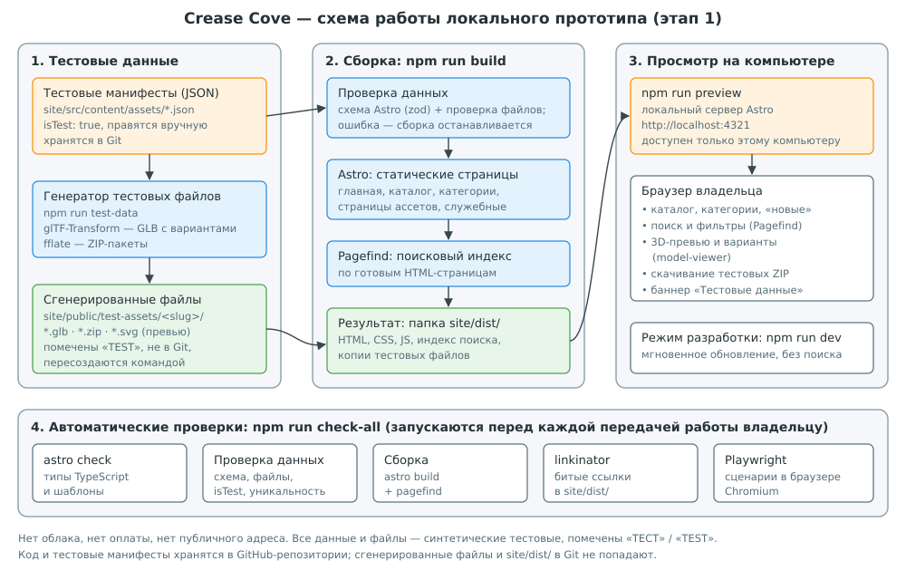

## 1. Сведения о документе {#s1}

| Параметр | Значение |
|---|---|
| Проект | Crease Cove: бесплатная библиотека 3D-ассетов (рабочее название) |
| Документ | Техническое задание (ТЗ) на разработку локального прототипа сайта |
| Версия и статус | 1.0, **проект**. Вступает в силу только после явного утверждения владельцем |
| Дата | 18 октября 2026 года. Версии инструментов проверены в реестре npm и на официальных сайтах в этот день |
| Основание | Исследование проекта, задание № 001, версия 1.1 (`docs/Crease_Cove_Project_Research.md`); замечания владельца от 18.10.2026 |
| Исполнитель | Claude (ИИ-ассистент, работает через Claude Code) |
| Заказчик и приёмщик | Владелец проекта Crease Cove |
| Бюджет | **0.** Только бесплатные инструменты. Никаких покупок, подписок, платных тарифов и регистраций |
| Результат этапа | Сайт, который работает на компьютере владельца по адресу `http://localhost:4321` на тестовых данных |

### 1.1. Как читать этот документ

Документ написан так, чтобы его можно было прочитать подряд и затем использовать как справочник.

- Разделы 2–3 объясняют, **что** делается и **как** организована работа.
- Раздел 4 — полный список ресурсов со ссылками для самостоятельного изучения. В подразделе 4.4 предложен порядок изучения.
- Разделы 5–9 описывают устройство прототипа: схему, папки, данные, страницы.
- Разделы 10–12 — требования и сценарии. По ним принимается работа.
- Разделы 13–14 — как запускать и как проверять.
- Разделы 15–18 — безопасность, риски, открытые вопросы и порядок утверждения.
- Раздел 19 — словарь терминов. Если встретилось непонятное слово, оно, скорее всего, там.

Каждое требование имеет номер (например, FR-07). Номер нужен, чтобы в замечаниях можно было ссылаться точно: «FR-07 не выполняется: …».

### 1.2. Что этот документ разрешает и чего не разрешает

Утверждение ТЗ разрешает **только этап 1**: разработку локального прототипа на тестовых данных в репозитории `Ceokii/Crease_Cove`. Оно не разрешает публичный запуск, деплой, покупку домена, использование облачных сервисов, платные услуги и производство реальных ассетов. Каждое из этих действий требует отдельного решения владельца (раздел 18).

## 2. Цель и границы работы

### 2.1. Цель этапа 1

Создать работающий локально прототип сайта Crease Cove, на котором владелец может:

1. увидеть структуру будущего каталога и навигацию;
2. проверить ключевые функции: каталог, категории, поиск, фильтры, страницу ассета, 3D-превью, переключение вариантов, скачивание пакетов;
3. оценить удобство и внешний вид и сформулировать правки;
4. принять решение о дальнейшем развитии (этап 3) на основе увиденного, а не только по описанию.

Прототип не является публичным сайтом и не содержит реальных ассетов.

### 2.2. Что входит в работу

| № | Работа | Результат |
|---|---|---|
| W1 | Каркас проекта сайта в папке `site/` | Проект Astro, который собирается и запускается |
| W2 | Схема данных и тестовые манифесты | Описание полей, 18 тестовых записей в JSON |
| W3 | Генератор тестовых файлов | Команда, создающая тестовые GLB, ZIP и превью |
| W4 | Страницы сайта | Главная, каталог, категории, страница ассета, поиск, служебные страницы |
| W5 | 3D-превью с вариантами | Просмотр тестовых GLB, переключение вариантов материалов |
| W6 | Поиск и фильтры | Работающий поиск по тестовым данным без сервера |
| W7 | Автоматические проверки | Одна команда проверяет типы, данные, сборку, ссылки и сценарии |
| W8 | Инструкция для владельца | `site/README.md`: установка и запуск по шагам для ОС владельца |
| W9 | Исправления по замечаниям владельца | Этап 2, в объёме согласованного списка |

### 2.3. Что не входит в работу

- Публикация сайта в интернете, деплой, хостинг, публичный адрес, доступ из локальной сети.
- Покупка или регистрация домена, создание аккаунтов в Cloudflare и любых других сервисах.
- Облачные хранилища и базы данных (R2, D1, Supabase и подобные).
- Реальные 3D-ассеты, работа в Blender, производственный конвейер.
- Аналитика, счётчики, cookie-баннеры, реклама, монетизация.
- Аккаунты пользователей, комментарии, рейтинги, загрузка моделей пользователями.
- Счётчик скачиваний и раздел «Популярные» (без реальных посетителей они не имеют смысла).
- Веб-админка. Тестовые данные редактируются в JSON-файлах.
- Финальные юридические тексты. В прототипе — заглушки с пометкой «черновик».
- Фирменный стиль и логотип. В прототипе — нейтральное оформление.

### 2.4. Жёсткие ограничения

| № | Ограничение | Как соблюдается |
|---|---|---|
| L1 | Бюджет 0 | Используются только бесплатные инструменты с открытыми лицензиями (раздел 4) |
| L2 | Никаких платных действий без явного согласия | Исполнитель не регистрирует аккаунты, не вводит платёжные данные, не включает платные тарифы |
| L3 | Только локальный запуск | Сервер слушает только `localhost`. Флаг `--host` запрещён (раздел 15) |
| L4 | Только тестовые данные | Каждая запись имеет `isTest: true`; сборка останавливается, если это не так (FR-02) |
| L5 | Тестовое нельзя выдать за реальное | Баннер на каждой странице, «ТЕСТ» в названиях, «TEST» в именах файлов (раздел 8.5) |
| L6 | Код появляется только после утверждения ТЗ | До утверждения в репозитории меняются только документы |
| L7 | Каждый следующий этап — только после одобрения предыдущего | Контрольные точки в разделе 3.3 |

## 3. Участники и порядок работы

### 3.1. Роли

| Роль | Кто | Ответственность |
|---|---|---|
| Владелец | Владелец проекта | Утверждает ТЗ, отвечает на открытые вопросы, тестирует прототип на своём компьютере, формулирует замечания, принимает работу, принимает решения о следующих этапах и о любых расходах |
| Исполнитель | Claude через Claude Code | Пишет код и документацию, создаёт тестовые данные, запускает проверки, готовит инструкции, исправляет замечания, сообщает о рисках и противоречиях |

Исполнитель не принимает решений, перечисленных в разделе 18.4, и не сливает изменения в основную ветку без согласия владельца.

### 3.2. Как исполнитель ведёт работу

1. **Где работает исполнитель.** Claude Code работает в изолированной облачной среде с копией репозитория. Там же он устанавливает пакеты, собирает сайт и запускает проверки. Эта среда предоставлена в рамках сессии Claude и не требует от владельца отдельных расходов. Сайт из неё не публикуется и снаружи не виден.
2. **Ветка.** Вся работа этапа 1 ведётся в отдельной ветке Git. Основная ветка (`main`) не меняется, пока владелец не одобрит результат.
3. **Коммиты.** Изменения сохраняются небольшими логическими шагами с понятными описаниями: «каркас Astro», «схема данных», «страница ассета» и т. д. Историю можно просмотреть на GitHub во вкладке Commits.
4. **Pull request (PR).** Для ветки открывается черновой PR. В нём видны все изменения, и владелец может оставлять комментарии к конкретным строкам.
5. **Проверки.** Перед каждой передачей результата исполнитель запускает `npm run check-all` (раздел 14.1) и прикладывает итог: что проверено и что прошло.
6. **Снимки экрана.** Вместе с результатом исполнитель присылает снимки ключевых страниц, сделанные в своей среде. По ним можно оценить вид до установки у себя.
7. **Отчёт.** В обсуждении проекта исполнитель пишет коротко: что сделано, как запустить, на что обратить внимание, какие вопросы остались.

### 3.3. Контрольные точки

| Точка | Что происходит | Кто решает | Что дальше |
|---|---|---|---|
| K0 | Утверждение ТЗ и ответы на вопросы D1–D6 (раздел 17) | Владелец | Только после K0 исполнитель начинает писать код |
| K1 | Промежуточный показ: каркас, тестовые данные, каталог и страница ассета без поиска | Владелец (по желанию) | Ранние замечания по структуре и виду |
| K2 | Сдача прототипа: все требования раздела 10, проверки пройдены, инструкция готова | Владелец | Начинается этап 2: тестирование у владельца |
| K3 | Список замечаний согласован и исправлен | Владелец | Повторная проверка; цикл повторяется, пока владелец не одобрит |
| K4 | Явное одобрение прототипа. PR сливается в `main` по команде владельца | Владелец | Этап 3: отдельное решение о дальнейшем (раздел 18.5) |

### 3.4. Как владелец получает и проверяет результат

1. Получает сообщение о готовности со ссылкой на PR и снимками экрана.
2. Однократно устанавливает Node.js и Git (раздел 13.1).
3. Скачивает ветку с прототипом и одной командой запускает сайт (раздел 13.2).
4. Открывает `http://localhost:4321` и проходит сценарии из раздела 12.
5. Записывает замечания в обсуждении проекта или в комментариях к PR.

Если установка покажется сложной, на первом показе (K1) достаточно снимков экрана. Установка нужна к K2.

### 3.5. Формат замечаний

Удобнее всего одна строка на замечание:

```
[страница или номер требования] — что ожидалось — что произошло — насколько важно (критично / важно / пожелание)
```

Пример: `Страница ассета, FR-11 — после выбора варианта «Синий» скачивается пакет «Красный» — критично`.

Исполнитель сводит замечания в таблицу, предлагает решение по каждому и согласует список с владельцем до исправлений (этап 2).

## 4. Ресурсы и инструменты

Все перечисленные ресурсы бесплатны. Версии проверены 18.10.2026. При старте этапа 1 исполнитель берёт актуальные стабильные версии в пределах тех же основных версий и фиксирует их в файле `package-lock.json`.

### 4.1. Программы на компьютере владельца

| Программа | Версия | Обязательна | Зачем | Лицензия | Где взять и что читать |
|---|---|---|---|---|---|
| Node.js | 24 LTS (линия «Krypton», сейчас 24.x) | Да | Среда, в которой работают Astro, сборка и генератор тестовых файлов. Вместе с ней ставится npm | MIT | [nodejs.org/download](https://nodejs.org/en/download); [расписание версий](https://nodejs.org/en/about/previous-releases) |
| npm | Идёт с Node.js | Да | Установка библиотек проекта и запуск команд | Artistic-2.0 | [docs.npmjs.com](https://docs.npmjs.com/) |
| Git | Актуальная стабильная | Да | Получение кода из репозитория и переключение веток | GPL-2.0 | [git-scm.com/downloads](https://git-scm.com/downloads); [книга Pro Git на русском](https://git-scm.com/book/ru/v2) |
| Браузер | Актуальный Chrome, Firefox, Edge или Safari | Да | Просмотр прототипа | — | Уже установлен |
| GitHub Desktop | Актуальная | Нет | Графическая замена командам Git | MIT | [desktop.github.com](https://desktop.github.com/) |
| Visual Studio Code | Актуальная | Нет | Удобный просмотр и правка файлов, включая тестовые JSON | Бесплатно (сборка Microsoft) | [code.visualstudio.com](https://code.visualstudio.com/); расширение [Astro](https://marketplace.visualstudio.com/items?itemName=astro-build.astro-vscode) |

Почему Node.js 24, а не новее: версия 24 — актуальная LTS-версия с длительной поддержкой. Версия 26 пока имеет статус Current, а поддержка версии 22 заканчивается. Astro 7 требует Node.js не ниже 22.22.0, поэтому 24 LTS подходит.

### 4.2. Библиотеки проекта

Устанавливаются автоматически командой `npm ci` в папку `site/node_modules`. Владельцу не нужно ставить их вручную.

| Пакет | Версия (18.10.2026) | Лицензия | Роль в прототипе | Документация |
|---|---|---|---|---|
| `astro` | 7.4.0 | MIT | Генератор статического сайта: страницы, шаблоны, сборка, локальный сервер, проверка данных | [docs.astro.build](https://docs.astro.build/); [CLI](https://docs.astro.build/en/reference/cli-reference/); [коллекции контента](https://docs.astro.build/en/guides/content-collections/) |
| `typescript` | 6.0.3 (линия 6.x) | Apache-2.0 | Язык с проверкой типов для скриптов и компонентов | [typescriptlang.org/docs](https://www.typescriptlang.org/docs/) |
| `@astrojs/check` | 0.9.10 | MIT | Команда `astro check`: проверка типов и шаблонов | [astro check](https://docs.astro.build/en/reference/cli-reference/#astro-check) |
| `pagefind` | 1.5.2 | MIT | Поиск и фильтры без сервера: индекс строится при сборке | [pagefind.app](https://pagefind.app/); [фильтры](https://pagefind.app/docs/filtering/) |
| `@google/model-viewer` | 4.4.0 | Apache-2.0 | Веб-компонент 3D-превью GLB с вращением, масштабом и вариантами материалов | [modelviewer.dev](https://modelviewer.dev/); [пример вариантов](https://modelviewer.dev/examples/scenegraph/) |
| `three` | 0.183.x | MIT | 3D-движок, на котором работает model-viewer. Версия ограничена требованием model-viewer (`^0.183.0`) | [threejs.org](https://threejs.org/) |
| `@gltf-transform/core`, `@gltf-transform/extensions` | 4.5.1 | MIT | Генерация тестовых GLB с вариантами материалов (`KHR_materials_variants`) | [gltf-transform.dev](https://gltf-transform.dev/); [варианты](https://gltf-transform.dev/modules/extensions/classes/KHRMaterialsVariants) |
| `fflate` | 0.8.3 | MIT | Создание тестовых ZIP-пакетов | [github.com/101arrowz/fflate](https://github.com/101arrowz/fflate) |
| `@playwright/test` | 1.64.1 | Apache-2.0 | Автоматические сценарии в браузере | [playwright.dev](https://playwright.dev/docs/intro) |
| `linkinator` | 8.1.0 | MIT | Проверка всех ссылок собранного сайта | [github.com/JustinBeckwith/linkinator](https://github.com/JustinBeckwith/linkinator) |

Проверка схемы данных использует Zod, который встроен в Astro (`astro/zod`), поэтому отдельная библиотека не нужна ([Zod](https://zod.dev/)).

Почему TypeScript 6, а не 7: последняя версия TypeScript — 7.0.2, но `@astrojs/check` 0.9.10 поддерживает только версии 5 и 6. Переход на 7 возможен, когда поддержка появится.

### 4.3. Стандарты и форматы

| Стандарт | Где используется | Что читать |
|---|---|---|
| glTF 2.0 и его двоичная форма GLB | Тестовые 3D-модели и превью | [Khronos: glTF](https://www.khronos.org/gltf/) |
| Расширение `KHR_materials_variants` | Варианты материалов в одном GLB | [спецификация](https://github.com/KhronosGroup/glTF/tree/main/extensions/2.0/Khronos/KHR_materials_variants) |
| JSON | Тестовые манифесты ассетов | [MDN: работа с JSON](https://developer.mozilla.org/en-US/docs/Learn_web_development/Core/Scripting/JSON) |
| ZIP | Пакеты для скачивания | — |
| SVG | Тестовые превью и схемы | [MDN: SVG](https://developer.mozilla.org/en-US/docs/Web/SVG) |
| WCAG 2.2 | Базовые требования доступности | [W3C: WCAG 2.2](https://www.w3.org/TR/WCAG22/) |

Для ручной проверки тестовых GLB можно открыть их в [glTF Sample Viewer](https://github.khronos.org/glTF-Sample-Viewer-Release/) от Khronos. Это необязательно.

### 4.4. Сервисы

| Сервис | Тариф | Зачем | Ограничения |
|---|---|---|---|
| GitHub, репозиторий `Ceokii/Crease_Cove` | Бесплатный | Хранение кода и документов, ветки, PR, обсуждение изменений | Уже существует, ничего нового не создаётся |
| Реестр npm | Бесплатный, без аккаунта | Скачивание библиотек | Аккаунт не нужен |
| GitHub Actions (автоматические проверки на GitHub) | **Не используется по умолчанию** | Могли бы запускать проверки при каждом изменении | Для приватных репозиториев бесплатный лимит минут ограничен. Подключается только по отдельному решению владельца |

Облачные сервисы из исследования (Cloudflare Workers, R2, D1 и другие) на этапе 1 **не используются**.

### 4.5. Рекомендуемый порядок изучения для владельца

| Шаг | Что изучить | Зачем владельцу | Примерное время |
|---|---|---|---|
| 1 | Основы Git: клонирование, ветки, коммиты; что такое PR на GitHub | Получать и просматривать работу | 1–2 ч |
| 2 | Как установить Node.js и запускать команды `npm` в терминале | Запускать прототип | 0,5–1 ч |
| 3 | Astro: раздел «Getting started», затем «Content collections» | Понимать, как устроены страницы и данные | 1–2 ч |
| 4 | Формат glTF/GLB и варианты материалов | Понимать, что будет в будущих реальных ассетах | 0,5–1 ч |
| 5 | model-viewer: демо-страница и пример вариантов | Видеть возможности 3D-превью | 0,5 ч |
| 6 | Pagefind: обзор и фильтры | Понимать, как работает поиск без сервера | 0,5 ч |
| 7 | JSON и файл манифеста этого проекта (раздел 7) | Самостоятельно править тестовые данные | 0,5 ч |

Изучение не обязательно для приёмки: для проверки прототипа достаточно разделов 12–13.

### 4.6. Что сознательно не используется и почему

| Инструмент | Почему не на этапе 1 |
|---|---|
| Next.js, Supabase (вариант Б из исследования) | Требуют сервера и базы данных; для статического прототипа избыточны |
| React, Vue и другие фреймворки интерфейса | Страницы прототипа обходятся HTML, CSS и небольшими скриптами. Меньше зависимостей, проще поддержка |
| CSS-фреймворки (Tailwind и др.) | Достаточно одного собственного файла стилей; меньше сущностей для изучения |
| Сторонние шрифты и CDN | Каждый внешний запрос нарушает принцип «всё локально». Используются системные шрифты |
| Аналитика, трекеры | Не нужны и создают обязательства по персональным данным |
| Blender | Реальные ассеты не производятся; тестовые модели генерируются скриптом |
| Cloudflare и любые облака | Только для возможной публичной версии, по отдельному решению |

### 4.7. Правила обновления версий

- Точные версии фиксируются в `site/package-lock.json`. У владельца и исполнителя ставятся одни и те же версии (команда `npm ci`).
- Обновление библиотек — отдельный коммит с пояснением причины.
- Переход на новую основную версию (например, Astro 8) — только с согласия владельца.
- Новые библиотеки, не перечисленные в разделе 4.2, добавляются только с согласия владельца, с указанием лицензии и причины.

## 5. Архитектура и схема работы прототипа

### 5.1. Общая схема



Прототип — **статический сайт**. Все страницы заранее собираются в готовые HTML-файлы. При просмотре нет сервера приложений и базы данных: локальный сервер Astro только отдаёт файлы браузеру.

### 5.2. Поток данных по шагам

1. **Тестовые манифесты.** Каждый тестовый ассет описан JSON-файлом в `site/src/content/assets/`. Это единственный источник сведений: название, категория, теги, габариты, варианты, форматы.
2. **Генерация тестовых файлов.** Команда `npm run test-data` читает манифесты и создаёт для каждого ассета GLB-модель с вариантами материалов, ZIP-пакеты для каждой пары «вариант × формат» и SVG-превью. Файлы кладутся в `site/public/test-assets/<slug>/`.
3. **Проверка данных.** При сборке Astro проверяет каждый манифест по схеме (раздел 7). Дополнительный скрипт проверяет, что все упомянутые файлы существуют, `isTest` равен `true`, а `slug` уникален. Любая ошибка останавливает сборку с понятным сообщением.
4. **Сборка страниц.** Astro создаёт HTML-страницы: главную, каталог, категории, страницу каждого ассета и служебные страницы. Результат — папка `site/dist/`.
5. **Поисковый индекс.** Pagefind читает готовые страницы и строит индекс поиска и фильтров в `site/dist/pagefind/`.
6. **Просмотр.** Команда `npm run preview` отдаёт `site/dist/` по адресу `http://localhost:4321`. Браузер загружает страницы, превью и пакеты только с этого адреса.
7. **Режим разработки.** Команда `npm run dev` показывает изменения сразу после сохранения файла. Поиск в этом режиме не работает, потому что индекс строится только при сборке.

### 5.3. Почему статический сайт

- Не нужен сервер и база данных, значит, нечего настраивать, оплачивать и защищать.
- Тот же результат сборки в будущем может быть размещён на любом статическом хостинге, в том числе бесплатном, без переписывания кода.
- Каталог из десятков и сотен позиций собирается за секунды.
- Поиск через Pagefind работает в браузере по заранее построенному индексу.

### 5.4. Связь с возможной публичной версией (без обязательств)

В исследовании описана возможная публичная архитектура на Cloudflare. Прототип спроектирован так, чтобы её не исключать: структура манифестов совместима с будущими реальными манифестами, а ссылки на пакеты собираются в одном месте и в будущем могут указывать на внешнее хранилище. Это не означает решения о публичной версии. Решение принимается на этапе 3.

## 6. Структура репозитория

```
Crease_Cove/
├── README.md                     # описание проекта (обновляется: «готовые пакеты» вместо «генерации на лету», если D6 подтверждён)
├── LICENSE                       # лицензия кода (MIT); к ассетам не относится
├── docs/
│   ├── Crease_Cove_Project_Research.md
│   ├── Crease_Cove_Technical_Specification.md   # этот документ
│   └── diagrams/
├── reports/                      # PDF-версии документов
└── site/                         # прототип (появится только после утверждения ТЗ)
    ├── README.md                 # инструкция для владельца: установка, запуск, проверка
    ├── package.json              # список библиотек и команд
    ├── package-lock.json         # точные версии библиотек
    ├── astro.config.mjs          # настройки Astro (только localhost, порт 4321)
    ├── tsconfig.json
    ├── playwright.config.ts
    ├── scripts/
    │   ├── generate-test-data.ts # создаёт GLB, ZIP и SVG по манифестам
    │   └── validate-data.ts      # дополнительные проверки данных
    ├── src/
    │   ├── content.config.ts     # схема манифеста (Zod)
    │   ├── content/
    │   │   ├── assets/           # тестовые манифесты: test-chair-01.json и т. д.
    │   │   └── categories.json   # справочник категорий и подкатегорий
    │   ├── components/           # повторяющиеся части страниц: карточка, баннер, превью
    │   ├── layouts/              # общий макет страницы
    │   ├── pages/                # страницы и маршруты (раздел 9)
    │   ├── scripts/              # небольшие скрипты в браузере: фильтры, варианты
    │   └── styles/global.css
    ├── public/
    │   └── test-assets/          # сгенерированные файлы (не в Git)
    ├── tests/                    # сценарии Playwright
    └── dist/                     # результат сборки (не в Git)
```

В Git не попадают: `node_modules/`, `dist/`, `public/test-assets/`, отчёты Playwright. Они пересоздаются командами. Правила записываются в `.gitignore`.

## 7. Модель данных

### 7.1. Манифест тестового ассета

Один JSON-файл на ассет. Имя файла совпадает с `slug`.

| Поле | Тип | Обязательно | Описание и правила |
|---|---|---|---|
| `isTest` | логическое | Да | Всегда `true`. Иное значение останавливает сборку |
| `slug` | строка | Да | Адрес страницы. Латиница в нижнем регистре, цифры, дефис. Начинается с `test-`. Уникален |
| `title` | строка | Да | Название. Начинается с «ТЕСТ — » |
| `description` | строка | Да | 1–3 предложения. Явно говорит, что объект синтетический |
| `category` | строка | Да | Идентификатор категории из `categories.json` |
| `subcategory` | строка | Да | Идентификатор подкатегории этой категории |
| `tags` | список строк | Да | 1–10 тегов в нижнем регистре; всегда содержит `test` |
| `style` | одно из значений | Да | `realistic`, `stylized`, `lowpoly` |
| `createdAt` | дата `ГГГГ-ММ-ДД` | Да | Для сортировки «новые» |
| `dimensions` | объект | Да | `{ "x": число, "y": число, "z": число }` в метрах, больше 0 |
| `triangles` | целое число | Да | Количество треугольников, больше 0. Для тестовых записей — заявленное значение, может не совпадать с моделью |
| `shape` | одно из значений | Да | Примитив для генератора: `box`, `cylinder`, `sphere`, `table`, `shelf` |
| `variants` | список объектов | Да | 1–4 варианта: `{ "id": "red", "name": "Красный (тест)", "color": "#c62828" }` |
| `formats` | список | Да | Подмножество `glb`, `blend`, `fbx`. `glb` обязателен |
| `license` | объект | Да | `{ "id": "TEST-ONLY", "name": "Тестовые данные, не для использования" }` |
| `provenance` | объект | Да | `{ "method": "generated-test-data", "aiAssisted": false, "notes": "…" }` |

Пути к файлам в манифест не записываются: они вычисляются из `slug`, `variants` и `formats` по правилам раздела 7.4. Это исключает расхождение между манифестом и файлами.

### 7.2. Пример манифеста

```json
{
  "isTest": true,
  "slug": "test-chair-01",
  "title": "ТЕСТ — Стул, вариант 1",
  "description": "Синтетический тестовый объект из примитивов. Не является реальным ассетом.",
  "category": "furniture",
  "subcategory": "chairs",
  "tags": ["test", "chair", "wood"],
  "style": "lowpoly",
  "createdAt": "2026-10-20",
  "dimensions": { "x": 0.45, "y": 0.9, "z": 0.5 },
  "triangles": 1240,
  "shape": "box",
  "variants": [
    { "id": "red", "name": "Красный (тест)", "color": "#c62828" },
    { "id": "blue", "name": "Синий (тест)", "color": "#1565c0" }
  ],
  "formats": ["glb", "blend", "fbx"],
  "license": { "id": "TEST-ONLY", "name": "Тестовые данные, не для использования" },
  "provenance": { "method": "generated-test-data", "aiAssisted": false, "notes": "Создан генератором тестовых данных" }
}
```

### 7.3. Справочник категорий

Файл `site/src/content/categories.json`: список категорий, у каждой — идентификатор, название и подкатегории. Тестовый набор по умолчанию (ответ на вопрос D5 может его изменить):

| Категория (id) | Подкатегории |
|---|---|
| Мебель (`furniture`) | Стулья, столы, полки |
| Предметы быта (`household`) | Посуда, декор |
| Инструменты (`tools`) | Ручные, садовые |
| Электроника (`electronics`) | Бытовая, компьютерная |
| Игровые пропсы (`game-props`) | Ящики, бочки |
| Окружение (`environment`) | Камни, растения |

### 7.4. Правила именования файлов

| Файл | Путь и имя |
|---|---|
| 3D-превью (все варианты внутри) | `/test-assets/<slug>/<slug>_TEST.glb` |
| Изображение-превью | `/test-assets/<slug>/<slug>_TEST.svg` |
| Пакет для скачивания | `/test-assets/<slug>/<slug>_<variant>_<format>_TEST.zip` |

### 7.5. Проверки данных

| № | Проверка | Где |
|---|---|---|
| V1 | Все обязательные поля есть, типы и форматы верны | Схема Zod при сборке Astro |
| V2 | `isTest` равен `true`, `slug` начинается с `test-`, название начинается с «ТЕСТ — » | Схема Zod |
| V3 | `slug` уникален и совпадает с именем файла | `validate-data.ts` |
| V4 | Категория и подкатегория есть в справочнике | `validate-data.ts` |
| V5 | Для каждого ассета существуют GLB, SVG и все ZIP по формуле раздела 7.4 | `validate-data.ts` |
| V6 | `id` вариантов уникальны внутри ассета | Схема Zod |

Сообщение об ошибке называет файл, поле и причину, например: `test-chair-01.json: поле "category": значение "furnitur" не найдено в categories.json`.

## 8. Тестовые данные

### 8.1. Состав набора

18 тестовых ассетов: по 3 на каждую из 6 категорий. Набор покрывает все случаи, которые нужно проверить:

- от 1 до 4 вариантов материалов;
- разные наборы форматов (только GLB; GLB и BLEND; все три);
- разные стили и значения полигонов, попадающие во все диапазоны фильтра;
- разные даты создания для сортировки;
- длинное название, чтобы проверить перенос строк;
- ассет без подкатегорий-соседей, чтобы проверить пустые и почти пустые списки.

### 8.2. Тестовые GLB

Генератор строит модели из простых геометрических примитивов (куб, цилиндр, сфера и их сочетания: «стол» — плита и четыре ножки, «полка» — несколько плит). Размеры берутся из `dimensions`. Каждому варианту соответствует материал своего цвета. Варианты записываются расширением `KHR_materials_variants`, поэтому model-viewer может переключать их без перезагрузки модели.

Модели не используют сжатие Draco и текстуры KTX2. Благодаря этому model-viewer не загружает внешние декодеры из интернета. Размер одного тестового GLB — не более 200 КБ.

### 8.3. Тестовые ZIP-пакеты

Для каждой пары «вариант × формат» создаётся ZIP-архив:

| Формат | Содержимое архива |
|---|---|
| GLB | GLB-модель только с выбранным вариантом, `README_TEST.txt`, `LICENSE_TEST.txt` |
| BLEND, FBX | Только `README_TEST.txt` и `LICENSE_TEST.txt`. В тексте прямо сказано, что это заглушка, а настоящий файл формата появится только у реальных ассетов |

`README_TEST.txt` содержит название ассета, вариант, формат, дату генерации и фразу «Тестовый файл прототипа Crease Cove. Не является реальным ассетом и не предназначен для использования».

### 8.4. Превью

SVG-изображение с цветом первого варианта, силуэтом примитива, названием и крупной надписью «ТЕСТ». Генерируется скриптом без дополнительных библиотек.

### 8.5. Маркировка тестовых данных

| Где | Как помечено |
|---|---|
| Каждая страница сайта | Неубираемый баннер вверху: «Прототип на тестовых данных. Ассеты не настоящие и не предназначены для использования» |
| Названия ассетов | Начинаются с «ТЕСТ — » |
| Имена файлов | Заканчиваются на `_TEST` |
| Превью | Надпись «ТЕСТ» на изображении |
| Содержимое архивов | `README_TEST.txt` и `LICENSE_TEST.txt` |
| Данные | Поле `isTest: true`, проверяется при сборке |
| Заголовок вкладки браузера | Начинается с «[ТЕСТ]» |

## 9. Страницы и навигация

| Маршрут | Страница | Содержимое |
|---|---|---|
| `/` | Главная | Кратко о проекте, баннер прототипа, плитка категорий, 6 новых ассетов, ссылка на каталог и поиск |
| `/catalog/` | Каталог | Все ассеты: карточки с превью, фильтры, сортировка, счётчик найденного |
| `/category/<категория>/` | Категория | Ассеты категории, список подкатегорий |
| `/category/<категория>/<подкатегория>/` | Подкатегория | Ассеты подкатегории |
| `/asset/<slug>/` | Страница ассета | 3D-превью, варианты, характеристики, выбор пакета и скачивание, лицензия, происхождение, похожие ассеты |
| `/search/` | Поиск | Строка поиска и фильтры (Pagefind); поддерживает адрес вида `/search/?q=стул` |
| `/license/` | Лицензия | Черновик: как будут лицензироваться реальные ассеты; пометка о тестовых данных |
| `/quality/` | Стандарт качества | Черновик: что гарантируется для реальных ассетов |
| `/about/` | О проекте | Черновик описания проекта |
| `/legal/terms/`, `/legal/privacy/`, `/legal/takedown/` | Правовые страницы | Заглушки «Черновик, будет подготовлен до любого публичного запуска» |
| любой несуществующий | 404 | Сообщение и ссылки на главную и каталог |

На всех страницах есть шапка (название, ссылки «Каталог», «Категории», «Поиск», «Лицензия»), баннер тестовых данных и подвал со ссылками на служебные страницы и пометкой «Локальный прототип».

## 10. Функциональные требования

Приоритет: **О** — обязательно для сдачи (K2); **Ж** — желательно, делается, если не мешает обязательному.

| № | Требование | Пр. | Критерий приёмки |
|---|---|---|---|
| FR-01 | Сайт собирается командой `npm run build` и запускается командой `npm run preview` на `http://localhost:4321` | О | Команды завершаются без ошибок; главная страница открывается |
| FR-02 | Сборка проверяет тестовые данные по разделу 7.5 и останавливается при ошибке | О | Если поменять `isTest` на `false` или удалить обязательное поле, сборка завершается с ошибкой, называющей файл и поле |
| FR-03 | Команда `npm run test-data` создаёт все тестовые файлы по манифестам | О | После удаления `public/test-assets/` и запуска команды все файлы созданы; повторный запуск даёт тот же результат |
| FR-04 | Баннер тестовых данных на каждой странице | О | Баннер виден на всех маршрутах раздела 9, включая 404; закрыть его нельзя |
| FR-05 | Главная страница по разделу 9 | О | Есть категории, 6 новых ассетов в порядке убывания даты, ссылки на каталог и поиск |
| FR-06 | Каталог с карточками | О | Показаны все 18 ассетов; карточка содержит превью, название, категорию, число вариантов, форматы, полигоны |
| FR-07 | Фильтры каталога: категория, формат, стиль, диапазон полигонов (до 1 000; 1 000–10 000; 10 000–50 000; более 50 000) | О | Выбор фильтров сокращает список и обновляет счётчик; сочетание фильтров работает как «и»; есть кнопка сброса |
| FR-08 | Сортировка каталога: новые, по названию, по полигонам | О | Порядок карточек меняется и соответствует выбранному правилу |
| FR-09 | Состояние фильтров и сортировки сохраняется в адресе страницы | Ж | Скопированная ссылка открывает каталог с теми же фильтрами |
| FR-10 | Страницы категорий и подкатегорий | О | Каждая категория и подкатегория из справочника имеет страницу; пустая подкатегория показывает понятное сообщение |
| FR-11 | Страница ассета: название, описание, категория со ссылкой, теги, габариты в метрах, полигоны, стиль, дата, варианты, форматы, лицензия, происхождение | О | Все поля манифеста отображаются и совпадают с JSON |
| FR-12 | 3D-превью: вращение мышью и касанием, масштаб, сброс вида | О | Модель видна, вращается и масштабируется; при ошибке загрузки показывается изображение-превью и сообщение |
| FR-13 | Переключение вариантов в превью | О | Выбор варианта меняет цвет модели без перезагрузки страницы |
| FR-14 | Выбор пакета и скачивание: вариант и формат, размер файла, кнопка «Скачать» | О | Скачивается ZIP с именем по разделу 7.4 для выбранных варианта и формата; размер на странице совпадает с реальным |
| FR-15 | Выбранный в превью вариант автоматически выбирается для скачивания | Ж | После переключения варианта в превью кнопка скачивания относится к нему |
| FR-16 | Поиск по названию, описанию и тегам | О | Запрос «стул» находит тестовые стулья; пустой результат показывает сообщение |
| FR-17 | Фильтры на странице поиска: категория, формат, стиль | О | Фильтры сужают результаты поиска |
| FR-18 | Поле поиска в шапке ведёт на `/search/?q=…` | Ж | Ввод и Enter открывают страницу поиска с результатами |
| FR-19 | Похожие ассеты на странице ассета: до 4 из той же подкатегории или категории | Ж | Блок показан, если такие ассеты есть |
| FR-20 | Служебные страницы и правовые заглушки по разделу 9 | О | Страницы открываются, помечены «Черновик» |
| FR-21 | Страница 404 | О | Несуществующий адрес показывает страницу 404 со ссылками |
| FR-22 | Хлебные крошки на страницах категорий и ассетов | Ж | Видна цепочка «Главная → Категория → Подкатегория → Ассет» со ссылками |
| FR-23 | Добавление тестового ассета без программирования | О | Инструкция в `site/README.md`: скопировать JSON, поменять поля, выполнить `npm run demo`; новый ассет появляется в каталоге и поиске |

## 11. Нефункциональные требования

| № | Требование | Критерий приёмки |
|---|---|---|
| NFR-01 | Нулевая стоимость | Ни одна команда и ни один инструмент не требует оплаты, аккаунта или платёжных данных |
| NFR-02 | Только локальный доступ | Сервер слушает только `localhost`; в конфигурации и командах нет `--host` |
| NFR-03 | Нет внешних запросов при просмотре | Автотест фиксирует, что все запросы браузера идут только на `localhost:4321` |
| NFR-04 | Поддержка браузеров | Последние версии Chrome, Firefox, Edge; Safari при наличии macOS |
| NFR-05 | Адаптивность | Страницы читаемы и работают при ширине экрана от 360 до 1920 пикселей, без горизонтальной прокрутки |
| NFR-06 | Скорость | Страница каталога открывается локально менее чем за 1 секунду; тестовый GLB — не более 200 КБ |
| NFR-07 | Доступность | Навигация с клавиатуры, видимый фокус, подписи к изображениям, контраст текста не ниже уровня AA WCAG 2.2 |
| NFR-08 | Воспроизводимость | Чистая установка `npm ci` → `npm run demo` даёт одинаковый результат у владельца и исполнителя |
| NFR-09 | Понятные ошибки | Ошибки данных и сборки называют файл, поле и причину на языке интерфейса |
| NFR-10 | Сопровождаемость | Код на TypeScript без ошибок `astro check`; зависимостей не больше, чем в разделе 4.2 |
| NFR-11 | Лицензии зависимостей | Только MIT, Apache-2.0 или сопоставимые разрешительные лицензии; список хранится в `site/README.md` |
| NFR-12 | Время сборки | Полная сборка 18 тестовых ассетов занимает менее 1 минуты на обычном ноутбуке |

## 12. Пользовательские сценарии для проверки владельцем

| № | Сценарий | Шаги | Ожидаемый результат |
|---|---|---|---|
| S1 | Знакомство | Открыть главную | Видны баннер теста, категории, новые ассеты |
| S2 | Поиск по категории | Главная → «Мебель» → «Стулья» → ассет | Страница ассета открывается, хлебные крошки верны |
| S3 | Поиск по слову | Поиск «стол» | Найдены тестовые столы; клик открывает ассет |
| S4 | Подбор с фильтрами | Каталог → формат FBX, стиль lowpoly, полигоны до 1 000 → сортировка по названию | Список соответствует условиям; сброс возвращает все 18 |
| S5 | Осмотр модели | Страница ассета → вращать, приблизить, сбросить вид | Модель отвечает на действия |
| S6 | Сравнение вариантов | Переключить все варианты | Цвет модели меняется; названия вариантов видны |
| S7 | Скачивание | Выбрать вариант и формат → «Скачать» → открыть архив | Имя архива и содержимое соответствуют выбору; внутри `README_TEST.txt` |
| S8 | Ошибочный адрес | Открыть `/asset/net-takogo/` | Страница 404 |
| S9 | Телефонная ширина | Сузить окно браузера или открыть режим устройства в инструментах разработчика | Меню, каталог и страница ассета удобны |
| S10 | Добавление тестового ассета | По инструкции FR-23 добавить свой JSON | Ассет появился в каталоге, категории и поиске |
| S11 | Защита от ошибок | Поменять в JSON `isTest` на `false` и запустить сборку | Сборка остановлена с понятной ошибкой |

## 13. Команды и запуск

### 13.1. Первичная установка (один раз)

Точная инструкция для операционной системы владельца будет в `site/README.md` после ответа на вопрос D3. Общий порядок:

1. Установить Node.js 24 LTS с [nodejs.org](https://nodejs.org/en/download) и Git с [git-scm.com](https://git-scm.com/downloads).
2. Проверить в терминале: `node --version` показывает `v24.…`, `git --version` показывает версию.
3. Скачать репозиторий и перейти в ветку прототипа:

```
git clone https://github.com/Ceokii/Crease_Cove.git
cd Crease_Cove
git checkout <ветка этапа 1, будет указана в сообщении о готовности>
cd site
npm ci
```

Команда `npm ci` скачивает библиотеки в папку `node_modules` (несколько сотен мегабайт). Нужен интернет; оплата не требуется.

### 13.2. Команды проекта

Все команды выполняются в папке `site/`.

| Команда | Что делает | Когда нужна |
|---|---|---|
| `npm run demo` | Создаёт тестовые файлы, собирает сайт и запускает просмотр на `http://localhost:4321` | Основная команда для владельца |
| `npm run test-data` | Создаёт тестовые GLB, ZIP и SVG по манифестам | После правки манифестов |
| `npm run dev` | Режим разработки с мгновенным обновлением (поиск не работает) | При правке страниц и стилей |
| `npm run build` | Проверяет данные, собирает сайт в `dist/`, строит индекс поиска | Перед просмотром |
| `npm run preview` | Показывает собранный сайт на `http://localhost:4321` | После сборки |
| `npm run check` | Проверка типов и шаблонов (`astro check`) | Исполнитель, перед сдачей |
| `npm run check-all` | Все автоматические проверки по разделу 14.1 | Исполнитель, перед сдачей; владельцу необязательно |

Остановить сервер: `Ctrl + C` в окне терминала.

### 13.3. Порт и доступ

Сайт доступен только на том компьютере, где запущен, по адресу `http://localhost:4321`. Если порт занят, Astro выберет следующий свободный и напишет адрес в терминале. Запуск с флагом `--host` открывает сайт другим устройствам сети; документация Astro предупреждает о рисках такого режима, поэтому в проекте он запрещён.

### 13.4. Частые проблемы

| Признак | Причина | Решение |
|---|---|---|
| `node: command not found` или «не является командой» | Node.js не установлен или терминал открыт до установки | Установить Node.js, открыть новый терминал |
| Ошибка о версии Node.js | Установлена версия ниже 22.22 | Установить 24 LTS |
| Поиск ничего не находит в режиме `dev` | Индекс строится только при сборке | Использовать `npm run demo` |
| 3D-превью серое или не загружается | Не созданы тестовые файлы | Выполнить `npm run test-data` |
| Сборка остановилась с ошибкой о JSON | Ошибка в тестовом манифесте | Исправить поле, указанное в сообщении |

## 14. План тестирования

### 14.1. Автоматические проверки (`npm run check-all`)

| № | Проверка | Инструмент | Что ловит |
|---|---|---|---|
| T1 | Типы и шаблоны | `astro check` | Ошибки в коде и компонентах |
| T2 | Данные | Схема Zod и `validate-data.ts` | Ошибки в манифестах, отсутствующие файлы, `isTest` |
| T3 | Сборка | `astro build` и `pagefind` | Невозможность собрать сайт или индекс |
| T4 | Ссылки | `linkinator` по папке `dist/` | Битые внутренние ссылки, отсутствующие файлы пакетов и превью |
| T5 | Сценарии | Playwright, Chromium | Сценарии S1–S8 автоматически; NFR-03 (нет внешних запросов); FR-04 (баннер на всех страницах); FR-14 (имя скачанного файла) |
| T6 | Отрицательная проверка данных | Playwright или отдельный скрипт | Испорченный тестовый манифест действительно останавливает сборку |

Исполнитель запускает эти проверки в своей среде перед каждой передачей результата и указывает итог в отчёте. Браузер для Playwright скачивается бесплатно; владельцу запускать T5 не обязательно.

### 14.2. Ручная проверка владельцем

Сценарии S1–S11 из раздела 12 в двух браузерах и на узкой ширине окна. Итог — список замечаний в формате раздела 3.5.

### 14.3. Критерии сдачи прототипа (K2)

- Все требования с приоритетом «О» выполнены.
- `npm run check-all` проходит без ошибок.
- `site/README.md` позволяет запустить прототип с нуля.
- В репозитории нет реальных ассетов, секретов и платных зависимостей.

### 14.4. Критерии завершения этапа 2 (K4)

- Все согласованные замечания исправлены или осознанно отложены с согласия владельца.
- Владелец явно написал, что одобряет прототип.

## 15. Безопасность и правила

| № | Правило |
|---|---|
| SEC-01 | Никаких ключей, паролей, токенов и персональных данных в репозитории и коде. Прототипу они не нужны |
| SEC-02 | Сервер только на `localhost`; флаг `--host` и настройка `server.host` запрещены |
| SEC-03 | Никаких внешних запросов со страниц: нет CDN, шрифтов из интернета, аналитики, счётчиков |
| SEC-04 | Библиотеки только из реестра npm, с фиксацией версий в `package-lock.json`; установка через `npm ci` |
| SEC-05 | Перед сдачей исполнитель запускает `npm audit` и сообщает о найденных уязвимостях; уязвимости в инструментах разработки, не попадающих на страницы, оцениваются отдельно |
| SEC-06 | Новые зависимости — только с согласия владельца, с указанием лицензии |
| SEC-07 | Никаких форм, отправляющих данные, и хранения данных посетителей |
| SEC-08 | Исполнитель не создаёт аккаунтов, не подключает сервисы и не меняет настроек репозитория (видимость, доступы, Actions) без согласия владельца |
| SEC-09 | Тестовые файлы не содержат чужих моделей, текстур и изображений: всё создаётся генератором |

## 16. Риски этапа 1

| № | Риск | Вероятность | Влияние | Мера |
|---|---|---|---|---|
| TR1 | Установка Node.js и Git вызывает трудности у владельца | Средняя | Среднее | Подробная пошаговая инструкция для ОС владельца; снимки экрана; на K1 достаточно снимков |
| TR2 | Тестовые данные примут за реальные | Низкая | Высокое | Маркировка по разделу 8.5, проверка `isTest` при сборке |
| TR3 | Разрастание объёма прототипа | Средняя | Среднее | Работа только по разделу 10; новое — через согласование изменения ТЗ |
| TR4 | Несовместимость версий библиотек | Низкая | Среднее | Версии проверены заранее; фиксация в `package-lock.json`; TypeScript 6 вместо 7 |
| TR5 | Различия в поведении на ОС владельца | Средняя | Низкое | Инструкция под ОС владельца (D3); проверка путей и команд под эту ОС |
| TR6 | model-viewer обращается к внешним ресурсам | Низкая | Среднее | Тестовые GLB без Draco и KTX2; автотест NFR-03 |
| TR7 | Прототип воспримут как готовность к публичному запуску | Средняя | Высокое | В ТЗ и интерфейсе прямо указано, что это локальный прототип; публичный запуск — только по отдельному решению |
| TR8 | Неожиданные расходы | Очень низкая | Высокое | Только бесплатные инструменты; исполнитель не вводит платёжных данных и не регистрирует аккаунтов |

## 17. Открытые вопросы, блокирующие начало этапа 1

| № | Вопрос | Варианты | Предложение исполнителя |
|---|---|---|---|
| D1 | Утверждение этого ТЗ | Утвердить / утвердить с правками / вернуть на доработку | — |
| D2 | Стек прототипа | Вариант А: Astro, статический сайт / Вариант Б: Next.js | Вариант А (раздел 4.6) |
| D3 | Операционная система компьютера владельца | Windows / macOS / Linux | Нужен ответ: от него зависит инструкция установки |
| D4 | Язык интерфейса прототипа | Русский / английский / оба | Русский для прототипа; тексты собраны в одном месте, чтобы позже добавить английский |
| D5 | Тестовые категории | Набор из раздела 7.3 / другой | Набор из раздела 7.3 |
| D6 | Готовые пакеты вместо генерации архивов «на лету» из README | Готовые пакеты / генерация на лету | Готовые пакеты; исправить README в рамках этапа 1 |

Если владелец утверждает ТЗ без ответа на D2, D4, D5 или D6, исполнитель применяет предложенный вариант. Без ответа на D3 исполнитель начинает работу, но инструкцию установки пишет для всех трёх систем.

## 18. Этапы, сроки и порядок утверждения

### 18.1. Шаги этапа 1

| Шаг | Работа | Результат | Требования |
|---|---|---|---|
| 1.1 | Каркас: Astro, TypeScript, настройки localhost, общий макет, баннер, `.gitignore` | Пустой сайт с шапкой, подвалом и баннером | FR-01, FR-04 |
| 1.2 | Схема данных, справочник категорий, 18 тестовых манифестов, проверки | Сборка проверяет данные | FR-02, раздел 7 |
| 1.3 | Генератор тестовых GLB, ZIP и SVG | Тестовые файлы | FR-03, раздел 8 |
| 1.4 | Главная, каталог, категории, страница ассета без превью | **Показ K1** | FR-05–FR-11 |
| 1.5 | 3D-превью, варианты, скачивание | Работающая страница ассета | FR-12–FR-15 |
| 1.6 | Поиск и фильтры Pagefind, служебные страницы, 404 | Полный набор страниц | FR-16–FR-22 |
| 1.7 | Автоматические проверки, `site/README.md`, исправление README проекта (если D6) | `check-all` проходит | FR-23, раздел 14 |
| 1.8 | Самопроверка, снимки экрана, отчёт | **Сдача K2** | Раздел 14.3 |

### 18.2. Трудоёмкость и стоимость

Оценки предварительные и согласуются с исследованием (раздел 19).

| Этап | Время исполнителя (ИИ) | Время владельца | Денежные расходы |
|---|---|---|---|
| Этап 1: разработка | 20–40 ч работы | 4–10 ч: установка, изучение, ответы | 0 |
| Этап 2: тестирование и правки | 5–20 ч | 3–10 ч: проверка и замечания | 0 |

Календарные сроки зависят от того, как быстро владелец отвечает на вопросы и проверяет результат. Исполнитель не начинает следующий шаг, требующий решения владельца, до получения ответа.

### 18.3. Процедура утверждения ТЗ

1. Владелец читает документ и задаёт вопросы в обсуждении проекта.
2. Владелец отвечает на вопросы D2–D6 или принимает предложения исполнителя.
3. Если нужны правки, исполнитель выпускает новую версию ТЗ с таблицей изменений.
4. Владелец явно пишет: «ТЗ утверждаю» (возможно, с оговорками). Это решение D1.
5. Только после этого исполнитель начинает шаг 1.1.

### 18.4. Решения, которые принимает только владелец

- Утверждение ТЗ и любые его изменения.
- Начало каждого этапа и переход между ними.
- Любые расходы, покупки, подписки, регистрации и подключение сервисов.
- Публичный доступ, деплой, доменное имя.
- Слияние ветки прототипа в `main`.
- Добавление библиотек сверх раздела 4.2 и переход на новые основные версии.
- Производство и публикация реальных ассетов, выбор их лицензии.

### 18.5. После этапа 2

На этапе 3 владелец выбирает направление: продолжить улучшать прототип, перейти к производству нескольких реальных ассетов, подготовить юридическую часть, остановиться или иное. Ни одно направление не начинается автоматически. Для выбранного направления готовится отдельное задание. Возможная подготовка к публичному запуску (этап 4) описана в исследовании, разделы 15 и 19, и требует отдельного решения, в том числе о расходах.

### 18.6. Изменения ТЗ

Любое изменение объёма, требований или ресурсов оформляется новой версией этого документа с таблицей изменений и утверждается владельцем. Мелкие уточнения, не меняющие требований (например, текст сообщения об ошибке), исполнитель вносит сам и упоминает в отчёте.

## 19. Словарь терминов

| Термин | Значение |
|---|---|
| Ассет | Готовый к использованию цифровой объект; здесь — 3D-модель с материалами |
| Баннер тестовых данных | Полоса вверху каждой страницы, сообщающая, что данные не настоящие |
| Ветка (Git) | Отдельная линия изменений; позволяет работать, не трогая основную версию |
| Вариант материала | Альтернативная окраска или материал одной и той же модели |
| Генератор тестовых данных | Скрипт, создающий тестовые файлы из описаний в JSON |
| Деплой | Публикация сайта на сервере в интернете. На этапе 1 не выполняется |
| Зависимость, библиотека, пакет | Готовый код из реестра npm, который использует проект |
| Индекс поиска | Заранее подготовленные данные, по которым поиск работает без сервера |
| Коммит | Сохранённый шаг изменений в Git с описанием |
| Манифест | JSON-файл с описанием одного ассета |
| Порт | Номер «входа» на компьютере, по которому браузер обращается к серверу; здесь 4321 |
| Сборка | Превращение исходного кода и данных в готовые страницы (`site/dist/`) |
| Схема данных | Правила, каким должен быть манифест: поля, типы, допустимые значения |
| Статический сайт | Сайт из заранее собранных файлов, без сервера приложений и базы данных |
| Тестовые данные | Синтетические записи и файлы, созданные только для проверки сайта |
| Черновой PR (pull request) | Предложение изменений на GitHub, которое можно смотреть и обсуждать до слияния |
| Astro | Инструмент для создания сайтов, собирает страницы из шаблонов и данных |
| GLB, glTF | Открытый формат 3D-моделей для веба; GLB — его однофайловая двоичная форма |
| `isTest` | Поле манифеста, обязательно равное `true` во всех данных прототипа |
| `localhost` | Имя «этого компьютера»; сайт по такому адресу не виден другим |
| LTS | Long Term Support: версия с длительной поддержкой |
| model-viewer | Веб-компонент Google для показа 3D-моделей на странице |
| Node.js, npm | Среда выполнения JavaScript вне браузера и менеджер её библиотек |
| `package-lock.json` | Файл с точными версиями всех библиотек проекта |
| Pagefind | Инструмент поиска для статических сайтов |
| Playwright | Инструмент, который сам открывает браузер и проходит сценарии |
| `slug` | Короткий латинский идентификатор ассета, используемый в адресе страницы |
| TypeScript | JavaScript с проверкой типов |
| Zod | Библиотека описания и проверки схемы данных, встроенная в Astro |

## 20. Источники

Все источники проверены 18.10.2026.

| № | Источник | Что подтверждает |
|---|---|---|
| T1 | [Node.js: версии и их статус](https://nodejs.org/en/about/previous-releases) | 24 — актуальная LTS; 26 — Current |
| T2 | [Astro: справочник CLI](https://docs.astro.build/en/reference/cli-reference/) | Команды `dev`, `build`, `preview`, `check`; порт 4321; предупреждение о `--host` |
| T3 | [Astro: коллекции контента](https://docs.astro.build/en/guides/content-collections/) | JSON-данные, загрузчики `glob()` и `file()`, проверка схемой Zod |
| T4 | [Реестр npm: astro](https://www.npmjs.com/package/astro) | Версия 7.4.0, MIT, требование Node.js ≥ 22.22.0 |
| T5 | [Реестр npm: @astrojs/check](https://www.npmjs.com/package/@astrojs/check) | Версия 0.9.10, поддержка TypeScript 5 и 6 |
| T6 | [Pagefind: фильтры](https://pagefind.app/docs/filtering/) | Фильтрация результатов поиска на статическом сайте |
| T7 | [model-viewer: варианты материалов](https://modelviewer.dev/examples/scenegraph/) | Переключение вариантов `KHR_materials_variants` |
| T8 | [Реестр npm: @google/model-viewer](https://www.npmjs.com/package/@google/model-viewer) | Версия 4.4.0, Apache-2.0, требование three ^0.183.0 |
| T9 | [glTF-Transform: KHRMaterialsVariants](https://gltf-transform.dev/modules/extensions/classes/KHRMaterialsVariants) | Создание вариантов материалов в GLB программно |
| T10 | [Спецификация KHR_materials_variants](https://github.com/KhronosGroup/glTF/tree/main/extensions/2.0/Khronos/KHR_materials_variants) | Формат вариантов материалов |
| T11 | [fflate](https://github.com/101arrowz/fflate) | Создание ZIP в JavaScript, MIT |
| T12 | [Playwright](https://playwright.dev/docs/intro) | Автоматические сценарии в браузере, Apache-2.0 |
| T13 | [linkinator](https://github.com/JustinBeckwith/linkinator) | Проверка ссылок локальной папки сайта, MIT |
| T14 | [WCAG 2.2](https://www.w3.org/TR/WCAG22/) | Требования доступности |
| T15 | Исследование проекта, задание № 001, версия 1.1 (`docs/Crease_Cove_Project_Research.md`) | Бизнес-контекст, сравнение вариантов, возможное будущее |
